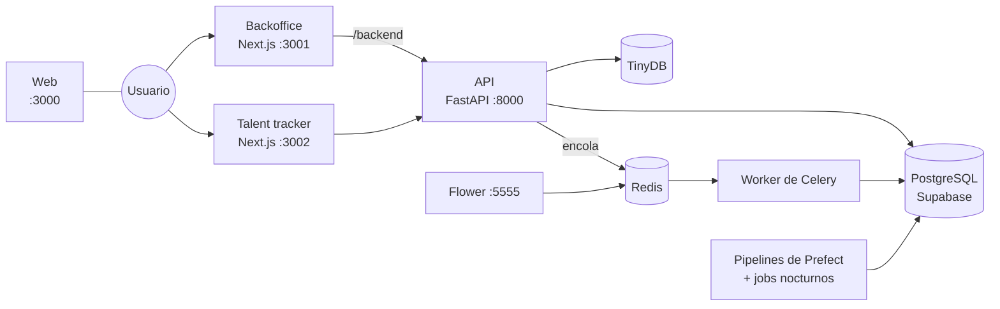

[English](README.md) | Español

# Nexova Platform

Proyecto final del **bootcamp de AI Engineering de 4Geeks Academy**: un monorepo que convierte a *Nexova Solutions*, una consultora ficticia de recursos humanos y selección (Valencia, 120 empleados), en una empresa *AI-native*. Cada necesidad de los departamentos se ha convertido en software real: una web pública, un backoffice interno, una API HTTP, una cola de tareas, pipelines de datos y telemetría.

> **Estado:** en desarrollo. Se construye por fases a lo largo del bootcamp; entrega final en diciembre de 2026.
> El briefing original de la empresa que proporciona 4Geeks está en [`docs/briefing.md`](docs/briefing.md).

## Qué contiene

| Parte | Ruta | Stack | Qué hace |
|---|---|---|---|
| Web corporativa | `uis/website` | HTML, CSS, JavaScript, schema.org (JSON-LD) | Web pública rediseñada con SEO/GEO y accesibilidad |
| Backoffice | `uis/backoffice` | Next.js 16, React 19, TypeScript, Tailwind CSS 4 | App interna: análisis de incidentes, gestor centralizado de incidencias, inventario, proveedores, reporting, reporte de telemetría, login y recuperación de contraseña |
| Talent pipeline tracker | `uis/talent-pipeline-tracker` | Next.js, TypeScript, Tailwind CSS | Seguimiento del pipeline de selección para los consultores |
| API | `services/api` | FastAPI, Pydantic, SQLModel, PostgreSQL (Supabase), TinyDB | Análisis de incidentes, directorio de proveedores, autenticación JWT, recuperación de contraseña por email, inventario y reporting |
| Cola de tareas | `services/task_queue` | Celery, Redis, Flower | Saca de la API las operaciones pesadas (`202 Accepted` + sondeo), con reintentos y tabla de *dead letters* |
| Pipelines de datos | `data/pipelines`, `data/process` | Prefect, pandas | Pipeline semanal de desempeño del negocio (KPIs) |
| Jobs nocturnos | `services/job_runner`, `scripts/nightly_export.py` | Python, PostgreSQL | Control de estado de los jobs y exportación nocturna de telemetría |
| Telemetría | `docs/telemetry`, `services/telemetry` | Esquemas de eventos JSON, pandas | Plan de telemetría, esquemas de eventos validados y reporte técnico |
| Paquetes compartidos | `packages/shared`, `packages/incident-analyzer` | Python | Validación compartida y núcleo del analizador de incidentes |
| Modelos de dominio | `src/` | TypeScript | Utilidades de scoring de candidatos y matching de vacantes |

## Arquitectura



## Ejecutarlo en local

Docker es el único modo soportado de arrancar la plataforma en desarrollo.

```bash
cp .env.example .env     # rellena las variables (ver docs/local-development.md)
docker compose up -d     # construye las imágenes la primera vez y arranca todo
```

| Servicio | URL |
|---|---|
| Web | http://localhost:3000 |
| Backoffice | http://localhost:3001 |
| API (documentación interactiva) | http://localhost:8000/docs |
| Flower (monitor de la cola) | http://localhost:5555 |

Necesitas una base de datos PostgreSQL (Supabase) en `DATABASE_URL`. El talent pipeline tracker se ejecuta fuera de Docker, en el puerto 3002. Guía completa: [`docs/local-development.md`](docs/local-development.md).

## Tests

Más de 2.000 tests automatizados en todo el monorepo (unittest/pytest, `node:test` y Jest). No hay un comando único: cada subproyecto valida el suyo. Los comandos están en [`AGENTS.md`](AGENTS.md), sección 4.

## Cómo está construido

Desarrollado con agentes de código bajo supervisión:

- **Contexto compartido:** un memory bank (`memory-bank/`) y reglas para los agentes (`AGENTS.md`, `CLAUDE.md`, `.agents/rules/`) mantienen la coherencia entre sesiones.
- **Pasos pequeños y revisados:** cada ticket se divide en fases, se verifica con tests y en el navegador, y se integra mediante pull requests.
- **Seguridad por defecto:** los secretos solo en el `.env` de la raíz (nunca en git), variables de entorno en lista blanca por contenedor e imágenes revisadas para que no contengan secretos.

## Autor

**Diego Reynoso Flores** · [GitHub](https://github.com/DiegoReynoso04)
