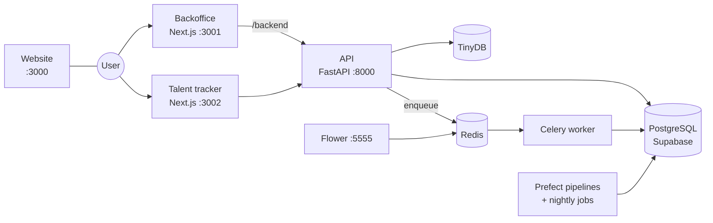

English | [Español](README.es.md)

# Nexova Platform

Capstone project of the **AI Engineering bootcamp at 4Geeks Academy**: a monorepo that turns *Nexova Solutions*, a fictional HR and recruiting consultancy (Valencia, 120 employees), into an AI-native company. Every department brief became a real piece of software: a public website, an internal backoffice, an HTTP API, a task queue, data pipelines and telemetry.

> **Status:** in progress. Built incrementally throughout the bootcamp; final delivery in December 2026.
> The original company brief provided by 4Geeks is in [`docs/briefing.md`](docs/briefing.md).

## What's inside

| Part | Path | Stack | What it does |
|---|---|---|---|
| Corporate website | `uis/website` | HTML, CSS, JavaScript, schema.org (JSON-LD) | Public website redesigned for SEO/GEO and accessibility |
| Backoffice | `uis/backoffice` | Next.js 16, React 19, TypeScript, Tailwind CSS 4 | Internal app: incident analysis, centralized incident manager, inventory, suppliers, reporting, telemetry report, login and password reset |
| Talent pipeline tracker | `uis/talent-pipeline-tracker` | Next.js, TypeScript, Tailwind CSS | Recruiting pipeline tracker for the selection consultants |
| API | `services/api` | FastAPI, Pydantic, SQLModel, PostgreSQL (Supabase), TinyDB | Incident analysis, supplier directory, JWT authentication, password reset by email, inventory and reporting |
| Task queue | `services/task_queue` | Celery, Redis, Flower | Moves heavy operations out of the API (`202 Accepted` + polling), with retries and a dead-letter table |
| Data pipelines | `data/pipelines`, `data/process` | Prefect, pandas | Weekly business-performance pipeline (KPIs) |
| Nightly jobs | `services/job_runner`, `scripts/nightly_export.py` | Python, PostgreSQL | Job state control and nightly telemetry export |
| Telemetry | `docs/telemetry`, `services/telemetry` | JSON event schemas, pandas | Telemetry plan, validated event schemas and technical report |
| Shared packages | `packages/shared`, `packages/incident-analyzer` | Python | Shared validation and the incident analyzer core |
| Domain models | `src/` | TypeScript | Candidate scoring and job matching utilities |

## Architecture



## Run it locally

Docker is the only supported way to start the platform in development.

```bash
cp .env.example .env     # fill in the variables (see docs/local-development.md)
docker compose up -d     # builds the images the first time and starts everything
```

| Service | URL |
|---|---|
| Website | http://localhost:3000 |
| Backoffice | http://localhost:3001 |
| API (interactive docs) | http://localhost:8000/docs |
| Flower (task queue monitor) | http://localhost:5555 |

You need a PostgreSQL database (Supabase) in `DATABASE_URL`. The talent pipeline tracker runs outside Docker on port 3002. Full guide: [`docs/local-development.md`](docs/local-development.md).

## Tests

More than 2,000 automated tests across the monorepo (unittest/pytest, `node:test` and Jest). There is no single test command: each subproject validates its own. The commands are listed in [`AGENTS.md`](AGENTS.md), section 4.

## How it's built

Developed with AI coding agents under supervision:

- **Shared context:** a memory bank (`memory-bank/`) and agent rules (`AGENTS.md`, `CLAUDE.md`, `.agents/rules/`) keep every session consistent.
- **Small, reviewed steps:** each ticket is split into stages, verified with tests and in the browser, and merged through pull requests.
- **Security by default:** secrets only in the root `.env` (never in git), allowlisted environment variables per container and images checked for leaked secrets.

## Author

**Diego Reynoso Flores** · [GitHub](https://github.com/DiegoReynoso04)
