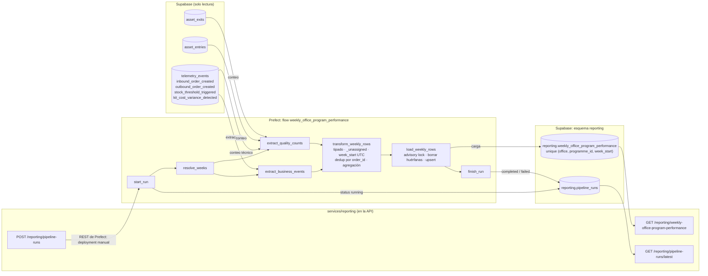

# Pipeline de desempeño de negocio — Diseño

**Reporte Semanal de Desempeño por Oficina y Programa** de Nexova Solutions, para Laura Mendoza (CEO) y Elena Vargas (Formación Corporativa, L&D).

> **Diseño aprobado el 2026-11-09; implementado en la Parte 2** (rama `feature/business-pipeline`), con los cambios que decidió el usuario en [`docs/reporting/implementation-analysis.md`](../../docs/reporting/implementation-analysis.md) (D1–D16). Esos cambios ya están en este documento: el código en `pipeline.py` (§4.1), la credencial y la guarda (§4.3), el perfil `pipelines` (§4.4), la frecuencia y el comando (§4.5) y el disparo manual (Fase 5). Guía de verificación: [`docs/reporting/implementation-review.md`](../../docs/reporting/implementation-review.md). En la demo todavía no se ha creado nada en Supabase.

| | |
|---|---|
| **BRIEFING** | [`docs/proyectos-de-data-pipeline-diseno-implementacion-subflows-tests.md`](../../docs/proyectos-de-data-pipeline-diseno-implementacion-subflows-tests.md): manda en los KPI, el grano, la tabla y los endpoints |
| **Contrato de eventos** | [`docs/telemetry/telemetry-plan.md`](../../docs/telemetry/telemetry-plan.md) y [`event-schemas.json`](../../docs/telemetry/event-schemas.json), versión `1.0.0` (este pipeline no la cambia) |
| **Almacén y API** | `services/api/SPECS.md` Parte F (inventario) y Parte H (telemetría) |
| **Análisis y decisiones** | [`docs/reporting/pipeline-analysis.md`](../../docs/reporting/pipeline-analysis.md): conflictos C1–C19 y decisiones D1–D14, aprobadas por el usuario el 2026-11-09. Aquí solo se usa el resultado |

**Decisiones que dan forma a este diseño:**

| ID | Decisión |
|---|---|
| D1 | `programme_id` nulo → centinela **`_unassigned`**, solo en el esquema `reporting`. Los eventos no cambian. P1 es un prerrequisito de negocio (§7.1) |
| D2 | Fuente: `telemetry_events` para los 4 KPI, más una **conciliación de solo lectura** con `asset_entries` y `asset_exits` que se guarda en el log y no cambia ningún KPI |
| D3 | Entran todos los eventos de los 4 tipos, sin filtrar por categoría |
| D4 | `kits_delivered_count` = conteo de órdenes; `kits_delivered_units` queda como propuesta de v2 |
| D5 | Lunes a las 06:00 `Europe/Madrid`; cada corrida programada recalcula la última semana cerrada y la anterior |
| D6 | Deduplicación por `event_id` (ingesta) y por id de orden dentro de la semana (transformación) |
| D7 | Flow y tasks en `data/pipelines/pipeline.py`; soporte en `data/pipelines/business_performance/`; transformación pura en `data/process/weekly_performance.py`; lecturas en `services/reporting/`; nombres compartidos en `nexova_shared.reporting` (D4 del análisis de implementación) |
| D8 | Prefect con servidor propio y un worker, en un perfil de Docker Compose; la API dispara las corridas por la API REST de Prefect, con `request_manual_run` de `business_performance/trigger.py` (librería estándar; D2 del análisis de implementación) |
| D9 | DDL del BRIEFING intacta + `run_id` y `CHECK` **aditivos**; migración explícita |
| D10 | Log de ejecución en `reporting.pipeline_runs` |
| D11 | Una sola corrida a la vez y guarda de retención |
| D12 | GET con cualquier rol, POST solo `admin`, sin caché |

---

## Fase 1 — Estado Actual

### 1.1 Eventos que se capturan hoy

Hoy llegan a la base **15 tipos de evento**: 14 los emite el backoffice (`uis/backoffice`, con `track()` de `lib/telemetry.ts`) y 1 la API (`direct_stock_edit_rejected`). Del catálogo de 52, el resto aún no se emite.

| Grupo | `event_type` |
|---|---|
| **Negocio (los 4 de este pipeline)** | `inbound_order_created`, `outbound_order_created`, `stock_threshold_triggered`, `kit_cost_variance_detected` |
| Negocio, fuera de este pipeline | `direct_stock_edit_rejected` |
| Técnicos | `page_viewed`, `page_not_found_viewed`, `form_started`, `form_submitted`, `form_abandoned`, `form_validation_failed`, `frontend_error_captured`, `client_request_failed`, `page_load_recorded`, `user_logged_out` |

**Los 4 eventos de negocio**, tal como se guardan (claves de `tags` de `services/api/app/modules/telemetry/allowlists.py`; todas obligatorias):

| `event_type` | Cuándo | Claves en `tags` |
|---|---|---|
| `inbound_order_created` | `POST /inventory/orders/inbound` responde 201 (una entrada en `asset_entries`) | `office`, `product_id`, `product_category`, `programme_id`, `quantity`, `currency`, `inbound_order_id`, `unit_cost`, `supplier_key`, `asset_category` |
| `outbound_order_created` | `POST /inventory/orders/outbound` responde 201 (una salida en `asset_exits`) | `office`, `product_id`, `product_category`, `programme_id`, `quantity`, `currency`, `outbound_order_id`, `exit_type`, `stock_after`, `asset_category` |
| `stock_threshold_triggered` | Una salida cruza el mínimo: `stock_before >= min_stock` y `stock_after < min_stock` | las 6 mínimas + `outbound_order_id`, `stock_before`, `stock_after`, `min_stock`, `asset_category` |
| `kit_cost_variance_detected` | El `unit_cost` de una entrada se desvía más del 10 % de la media de las 3 anteriores del mismo activo y proveedor | las 6 mínimas + `inbound_order_id`, `supplier_key`, `unit_cost`, `reference_unit_cost`, `variance_pct`, `direction`, `threshold_pct`, `reference_window`, `asset_category` |

Hechos que condicionan el pipeline:

- **`office`** va en minúsculas (`valencia`/`miami`) y **`currency`** es la de la oficina (`EUR`/`USD`). El colector rechaza un par incoherente: un evento de `miami` en `EUR` no se guarda.
- **`programme_id` y `product_category` van siempre en `null`**: la clasificación de activos (P1) no existe todavía.
- **`unit_cost`** es obligatorio en cada entrada nueva (`NUMERIC(12,2)`, `> 0`). Las entradas anteriores a ese cambio y las del seed no tienen coste y **nunca emitieron evento**.
- **`inbound_order_created` no se emite si la API no tiene `TELEMETRY_SUPPLIER_KEY`** (sin ella, `supplier_key` es `null` y el esquema lo exige).
- **`min_stock`** es 5 para todos los activos (`INVENTORY_DEFAULT_MIN_STOCK`); el mínimo por activo (P2) no existe todavía.

### 1.2 Dónde se guardan

Tabla **`telemetry_events`** (PostgreSQL en Supabase, la misma base que el inventario):

| Columna | Tipo | Notas |
|---|---|---|
| `event_id` | `UUID` PK | El `eventId` del cliente. `INSERT … ON CONFLICT (event_id) DO NOTHING`: un reintento no duplica |
| `event_type` | `VARCHAR(64)`, índice | |
| `timestamp` | `TIMESTAMPTZ`, índice | El del cliente si está a **±5 min** de la recepción; si no, el de recepción |
| `service` | `VARCHAR(16)` | `backoffice` (colector) o `api` |
| `user_id`, `session_id` | `UUID` | Seudónimos. **Este pipeline no los lee** |
| `schema_version` | `VARCHAR(16)` | `1.0.0` |
| `tags` | `JSONB`, índice GIN | `properties` filtradas por la allowlist del evento |

- **Inmutable:** `REVOKE UPDATE, DELETE, TRUNCATE` a todos los roles; RLS sin políticas cierra la Data API de Supabase. Ninguna fila cambia después de escribirse.
- **Entrada:** `POST /telemetry/events`, público (un `sendBeacon` no lleva token), con allowlist y throttle de 120 eventos/min.
- **Retención:** 90 días para los eventos en bruto; **primera fecha límite: 2027-02-03**, con la condición de **agregar antes de borrar**. Los agregados sin identificadores se conservan sin límite.

Las órdenes también están en el inventario, que es su fuente de verdad: **`asset_entries`** (`id`, `asset_id`, `quantity`, `office` `Valencia`/`Miami`, `created_at`, `user_uuid`, `unit_cost`, `currency`, `supplier`) y **`asset_exits`** (`id`, `asset_id`, `quantity`, `exit_type`, `assigned_to`, `office`, `created_at`, `user_uuid`). **Solo inserción**: no hay rutas de edición ni de borrado.

### 1.3 Qué responde hoy el reporte técnico

`GET /telemetry/report` (`services/telemetry/analysis.py`, Pandas) da 5 métricas **técnicas** de una ventana de hasta 90 días: `events_per_day`, `error_rate_by_type`, `page_load_latency_by_route`, `dominant_event_types` y `auth_failure_rate`. **Ninguna lee `office`, `programme_id`, `quantity`, `unit_cost` ni `currency`**: los 4 eventos de negocio solo cuentan como filas. Este pipeline **no lo modifica**.

### 1.4 Datos reales de la demo

Recuento de solo lectura del 2026-11-09 (66 filas en `telemetry_events`):

| `event_type` | Semana (`week_start`) | `office` | `programme_id` | Eventos |
|---|---|---|---|---|
| `inbound_order_created` | 2026-11-02 | `valencia` | `null` | 1 |
| `outbound_order_created` | 2026-11-02 | `miami` | `null` | 1 |
| `stock_threshold_triggered` | 2026-11-02 | `miami` | `null` | 1 |
| `kit_cost_variance_detected` | — | — | — | 0 |

### 1.5 La brecha de negocio

| Lo que necesitan Laura y Elena | Lo que hay hoy |
|---|---|
| Un consolidado **semanal** que Laura abra sin llamar a Elena ni a Patricia | El informe semanal se prepara a mano; nadie agrega los eventos de negocio |
| Por **oficina** (Valencia y Miami, lado a lado) | Los eventos traen `office`, pero ningún proceso los suma |
| Por **programa** | `programme_id` es `null` en el 100 % de los eventos (P1 pendiente) |
| Coste de material, kits entregados, escasez y variación de coste | Los 4 eventos existen; el reporte técnico no los mira |
| Que el dato sobreviva a la purga de 90 días | No hay agregados: el 2027-02-03 se perdería el histórico |

---

## Fase 2 — Diseño del pipeline

### 2.1 Propósito

> **Cada lunes por la mañana, el pipeline consolida en `reporting.weekly_office_program_performance`, por `office`, `programme_id` y semana ISO, el «Reporte Semanal de Desempeño por Oficina y Programa» de Laura y Elena —los KPI Costo de material, Kits entregados, Frecuencia de escasez y Frecuencia de variación de costo— a partir de las 4 métricas obligatorias `inbound_order_created`, `outbound_order_created`, `stock_threshold_triggered` y `kit_cost_variance_detected` de `telemetry_events`.**

### 2.2 KPI y cómo se calcula cada uno

Grano: **una fila por `office` × `programme_id` × `week_start`** (lunes ISO, UTC). Cada columna es un KPI del BRIEFING.

| KPI | Columna | Fórmula | `event_type` |
|---|---|---|---|
| Costo de material por oficina/programa | `total_material_cost` | Σ `unit_cost × quantity`, en `numeric` (nunca `float`), en la moneda de la oficina | `inbound_order_created` |
| Kits entregados | `kits_delivered_count` | Conteo de órdenes distintas (`outbound_order_id`) | `outbound_order_created` |
| Frecuencia de escasez | `shortage_events_count` | Conteo de cruces distintos (`outbound_order_id`) | `stock_threshold_triggered` |
| Frecuencia de variación de costo | `cost_variance_events_count` | Conteo de entradas distintas (`inbound_order_id`) | `kit_cost_variance_detected` |
| — | `currency` | `EUR` si `office = 'valencia'`, `USD` si `miami`. **Nunca se convierte ni se suma entre oficinas** | — |

> **Kits entregados: órdenes frente a unidades (ambigüedad abierta).** La fórmula del BRIEFING dice «conteo de `outbound_order_created`», y el KPI pregunta «cuántos kits o certificados se entregaron». Una salida de 12 unidades es **1** en `kits_delivered_count`. La v1 sigue la fórmula literal. **Propuesta de v2:** una columna aditiva `kits_delivered_units integer not null default 0` = Σ `quantity`, si Elena necesita unidades. `allocation` y `consumption` cuentan igual: el BRIEFING no los distingue y el inventario no modela a quién se entrega (cliente, candidato, consultor o agente).

> **Coste:** el evento ya trae `unit_cost` y `quantity`, así que **no hace falta ampliar el esquema** (el BRIEFING lo pide solo si falta el coste). Las entradas sin evento (sin coste o sin `TELEMETRY_SUPPLIER_KEY`) no suman; la conciliación las hace visibles (§2.5).

> **Material:** entran todos los activos del inventario, no solo los de formación. Con `product_category` siempre nulo, filtrar dejaría el reporte vacío. Filtrar por categoría cuando exista P1 es un cambio de definición del KPI (§7.1).

### 2.3 Formato de extracción

**Tablas origen (todas en solo lectura):**

| Tabla | Para qué | Qué se lee |
|---|---|---|
| `telemetry_events` | Los 4 KPI | `event_id`, `event_type`, `timestamp` y **solo** 6 claves de `tags`: `office`, `programme_id`, `currency`, `quantity`, `unit_cost`, `inbound_order_id`/`outbound_order_id` |
| `telemetry_events` | Calidad: ¿silencio o ausencia? | Conteo por semana de los eventos **no** de negocio, sin leer sus `tags` |
| `asset_entries`, `asset_exits` | Conciliación (no cambia los KPI) | Conteo por semana y `lower(office)`; en `asset_entries`, solo las filas con `unit_cost` |

**Nunca se leen:** `user_id`, `session_id`, `supplier_key`, `assigned_to`, `supplier`, `user_uuid` ni ninguna otra clave de `tags`.

**Ventana:** las semanas pedidas, de `week_from` (lunes, 00:00 UTC) a `week_to + 7 días` (exclusivo).

```sql
-- extract_business_events (pseudocódigo SQL; parámetros :window_start y :window_end en UTC)
SELECT event_id,
       event_type,
       "timestamp",
       tags->>'office'           AS office,
       tags->>'programme_id'     AS programme_id,
       tags->>'currency'         AS currency,
       tags->>'quantity'         AS quantity,
       tags->>'unit_cost'        AS unit_cost,
       COALESCE(tags->>'inbound_order_id', tags->>'outbound_order_id') AS order_id
FROM telemetry_events
WHERE event_type IN ('inbound_order_created', 'outbound_order_created',
                     'stock_threshold_triggered', 'kit_cost_variance_detected')
  AND "timestamp" >= :window_start
  AND "timestamp" <  :window_end
ORDER BY "timestamp", event_id;
```

Las claves se extraen como texto y se tipan en la transformación: un valor inesperado cuenta en `rows_rejected` en lugar de tumbar la extracción.

**Forma de cada registro extraído** (payload que pasa de la extracción a la transformación):

| Campo | Tipo | Ejemplo |
|---|---|---|
| `event_id` | UUID | `51e4476a-0ac6-4710-86d7-daa6e495839c` |
| `event_type` | texto (uno de los 4) | `inbound_order_created` |
| `timestamp` | `datetime` con zona (UTC) | `2026-11-03T09:15:42.318Z` |
| `office` | `valencia` / `miami` | `valencia` |
| `programme_id` | slug o `null` | `null` |
| `currency` | `EUR` / `USD` | `EUR` |
| `quantity` | texto → entero ≥ 1 | `"12"` |
| `unit_cost` | texto → decimal > 0 (solo entradas) | `"18.5"` |
| `order_id` | texto → entero ≥ 1 (`inbound_order_id` u `outbound_order_id`) | `"41"` |

**Cadencia:** semanal, **lunes a las 06:00 `Europe/Madrid`** (05:00 UTC en invierno, 04:00 UTC en verano). La semana cierra el lunes a las 00:00 UTC y, por la regla de ±5 min del colector, desde las 00:05 UTC ya no puede entrar ningún evento suyo: el margen es de al menos 4 h. Además, corridas manuales (`POST /reporting/pipeline-runs`) y un backfill opcional.

### 2.4 Diagrama: extracción → transformación → carga



### 2.5 Transformación (`transform_weekly_rows`, función pura)

1. **Tipar y validar** cada registro: `office` en `valencia`/`miami`; `currency` coherente con la oficina; `quantity` entero ≥ 1; `unit_cost` decimal > 0 en `inbound_order_created`; `order_id` entero ≥ 1. Un registro que no cumple se descarta y cuenta en `rows_rejected` (no debería pasar: la allowlist del colector ya lo garantiza).
2. **Programa:** `programme_id` nulo → **`_unassigned`**. El centinela no cumple el patrón slug `^[a-z0-9]+(-[a-z0-9]+)*$`, así que nunca coincide con un programa real.
3. **Semana:** `week_start` = lunes de la semana ISO de `timestamp` en UTC (equivale a `date_trunc('week', "timestamp" AT TIME ZONE 'UTC')::date`).
4. **Deduplicar por orden:** por (`event_type`, `office`, `week_start`, `order_id`) se queda el primero por (`timestamp`, `event_id`); los descartados suman `duplicates_collapsed`.
5. **Agregar** por (`office`, `programme_id`, `week_start`) según §2.2. Si una celda tuviera dos monedas, la corrida **falla** (`DataQualityError`) en lugar de mezclarlas.
6. **Salida:** una fila por celda con al menos un evento. **No se inventan filas a 0:** una semana calculada sin actividad no tiene filas, y el log dice que se calculó.
7. **Calidad:** por semana, eventos técnicos y, por semana y oficina, entradas con coste y salidas del inventario frente a los eventos de negocio. Va a `pipeline_runs.quality`; **no cambia ningún KPI**.

### 2.6 Registros que se actualizan y duplicados

| Dónde | ¿Se actualiza? | Estrategia |
|---|---|---|
| `telemetry_events` | **Nunca** (inmutable) | Sin CDC ni marca de agua: recalcular una semana con los mismos eventos da siempre el mismo resultado. Se recalcula por ventana de semanas |
| `asset_entries`, `asset_exits` | Solo inserción | Solo se cuentan. Excepción: la restauración de la demo (`TRUNCATE … RESTART IDENTITY`, con confirmación del usuario) reinicia los ids |
| `reporting.weekly_office_program_performance` | Sí, por el pipeline | Upsert sobre `unique (office, programme_id, week_start)` + borrado, en la misma transacción, de las filas de las semanas recalculadas que ya no salen (§3.1) |

**Duplicados, en tres capas:**

1. **Ingesta:** `event_id` es la PK y el colector inserta con `ON CONFLICT (event_id) DO NOTHING`.
2. **Transformación:** una orden cuenta una vez por semana, aunque llegue con dos `eventId` distintos (reenvío o inyección por la ruta pública). Riesgo documentado: tras un `TRUNCATE … RESTART IDENTITY` a mitad de semana, dos órdenes reales con el mismo id contarían una; `duplicates_collapsed` lo delata.
3. **Carga:** el `unique` impide dos filas de la misma celda; una corrida repetida sobrescribe.

**Eventos tardíos:** un `timestamp` guardado nunca es anterior a la recepción en más de 5 min. Un evento que el navegador reenvía mucho después se fecha en la recepción y cae en la semana en que llegó: no es «tardío», está en otra semana.

### 2.7 Tabla de destino

`reporting.weekly_office_program_performance`, con la DDL del BRIEFING **intacta** (nombre, columnas, tipos, valores por defecto y `unique`). Lo marcado como **aditivo** no está en el BRIEFING:

```sql
create schema if not exists reporting;

-- reporting.pipeline_runs va antes (§3.3): la FK aditiva apunta a ella.

create table reporting.weekly_office_program_performance (
  -- DDL del BRIEFING, sin cambios
  id uuid primary key default gen_random_uuid(),
  office text not null,
  programme_id text not null,
  week_start date not null,
  total_material_cost numeric not null default 0,
  kits_delivered_count integer not null default 0,
  shortage_events_count integer not null default 0,
  cost_variance_events_count integer not null default 0,
  currency text not null,
  computed_at timestamptz not null default now(),
  unique (office, programme_id, week_start),

  -- ADITIVO: rastro de la corrida que escribió la fila
  run_id uuid not null references reporting.pipeline_runs (run_id),

  -- ADITIVO: CHECK como segunda barrera tras la transformación
  constraint ck_wopp_office check (office in ('valencia', 'miami')),
  constraint ck_wopp_currency check (
    (office = 'valencia' and currency = 'EUR') or (office = 'miami' and currency = 'USD')),
  constraint ck_wopp_programme check (
    programme_id = '_unassigned' or programme_id ~ '^[a-z0-9]+(-[a-z0-9]+)*$'),
  constraint ck_wopp_week_start_monday check (extract(isodow from week_start) = 1),
  constraint ck_wopp_non_negative check (
    total_material_cost >= 0 and kits_delivered_count >= 0
    and shortage_events_count >= 0 and cost_variance_events_count >= 0)
);
```

- **`computed_at`:** en el alta lo pone `default now()`; en el `DO UPDATE` del upsert se fija `now()` explícitamente (el default no se aplica al actualizar). `now()` es la hora de inicio de la transacción: **todas las filas de una carga comparten el mismo `computed_at`**.
- **`gen_random_uuid()`** es nativa en PostgreSQL ≥ 13 (sin `pgcrypto`).
- **Migración explícita** (patrón de `app/modules/telemetry/migrate.py`): `python -m business_performance.migrate --dry-run` imprime la SQL pendiente; sin `--dry-run`, la aplica en una transacción. Idempotente, solo PostgreSQL, **nunca al arrancar** y **en la base de la demo solo con la confirmación del usuario**. Crea el esquema, `pipeline_runs`, esta tabla y sus índices; activa RLS sin políticas y hace `REVOKE ALL` sobre el esquema y las tablas a `PUBLIC`, `anon`, `authenticated` y `service_role`. `reporting` **no** se añade a los esquemas expuestos de la Data API de Supabase.
- **Roles:** en la v1, el rol actual de la API (dueño de las tablas), como el inventario y la telemetría. Mejora documentada: un rol del pipeline (`SELECT` en `telemetry_events`, `asset_entries` y `asset_exits`; escritura en `reporting`) y la API con solo `SELECT` en `reporting`.
- **Artefacto:** cuando exista, `data/process/README.md` documentará esta tabla como el resultado del pipeline (sin archivos de datos en git).

### 2.8 Endpoints

Tres rutas nuevas en `services/reporting/`, detalladas en la Fase 5: `GET /reporting/weekly-office-program-performance`, `GET /reporting/pipeline-runs/latest` y `POST /reporting/pipeline-runs`.

---

## Fase 3 — Idempotencia y log de ejecución

### 3.1 La carga: una transacción

```sql
-- load_weekly_rows: todo en UNA transacción
BEGIN;

-- Una sola carga a la vez (válido con el Transaction pooler de Supabase:
-- un lock de sesión no lo sería, porque cada transacción puede ir por otra conexión).
SELECT pg_advisory_xact_lock(hashtext('weekly_office_program_performance'));

-- 0. El resultado de transform_weekly_rows, en una tabla temporal que solo vive
--    en esta transacción (válido con el Transaction pooler). Puede quedar vacía.
CREATE TEMP TABLE new_cells (
  office text, programme_id text, week_start date,
  total_material_cost numeric, kits_delivered_count integer,
  shortage_events_count integer, cost_variance_events_count integer, currency text
) ON COMMIT DROP;
INSERT INTO new_cells VALUES (/* filas de transform_weekly_rows; ninguna si no hubo actividad */);

-- 1. Filas de las semanas recalculadas que no están en el resultado nuevo.
DELETE FROM reporting.weekly_office_program_performance AS w
WHERE w.week_start BETWEEN :week_from AND :week_to
  AND NOT EXISTS (
    SELECT 1 FROM new_cells AS n
    WHERE n.office = w.office
      AND n.programme_id = w.programme_id
      AND n.week_start = w.week_start);

-- 2. Upsert del resultado (una fila por celda; nada si new_cells está vacía).
INSERT INTO reporting.weekly_office_program_performance
  (office, programme_id, week_start, total_material_cost, kits_delivered_count,
   shortage_events_count, cost_variance_events_count, currency, run_id)
SELECT office, programme_id, week_start, total_material_cost, kits_delivered_count,
       shortage_events_count, cost_variance_events_count, currency, :run_id
FROM new_cells
ON CONFLICT (office, programme_id, week_start) DO UPDATE SET
  total_material_cost        = EXCLUDED.total_material_cost,
  kits_delivered_count       = EXCLUDED.kits_delivered_count,
  shortage_events_count      = EXCLUDED.shortage_events_count,
  cost_variance_events_count = EXCLUDED.cost_variance_events_count,
  currency                   = EXCLUDED.currency,
  computed_at                = now(),
  run_id                     = EXCLUDED.run_id;

COMMIT;
```

- **Por qué el `DELETE`:** sin él, el upsert solo sobrescribiría, y una celda que deja de tener eventos al recalcular conservaría su fila vieja.
- **Por qué `NOT EXISTS` y no `NOT IN`:** con un resultado vacío, `NOT IN ()` ni siquiera es SQL válido; `NOT EXISTS` contra `new_cells` funciona con cero filas.
- **Semana sin actividad:** si `new_cells` está vacía, **se borran todas las filas de las semanas recalculadas** (`week_from` a `week_to`) y el `INSERT` no escribe nada. Es lo correcto: esas semanas no tuvieron eventos, y el log (`week_from`, `week_to`, `status = 'completed'`) deja constancia de que se calcularon.

### 3.2 Qué pasa EXACTAMENTE en la segunda corrida tras un fallo en la carga

**Escenario.** La corrida **R1** (cron del lunes 2026-11-16, semanas 2026-11-02 y 2026-11-09) extrae y transforma bien; `mark_phase` ha dejado `phase = 'load'` en su fila, y la conexión se corta durante el upsert de `load_weekly_rows`.

**Lo que deja R1:**

1. PostgreSQL **deshace la transacción entera**: ni el `DELETE` ni el upsert se aplican. La tabla queda **exactamente como antes de R1**, con los valores, `computed_at` y `run_id` de la corrida anterior (R0). No hay estados intermedios.
2. Prefect reintenta `load_weekly_rows` (2 reintentos, 30 s entre ellos). Cada reintento es una transacción nueva y completa. Si uno sale bien, R1 termina `Completed` y ya no hay «segunda corrida».
3. Si los 3 intentos fallan, la task queda `Failed`, y el flow ejecuta `finish_run` en otra transacción: R1 pasa a `status = 'failed'`, `phase = 'load'`, `error_class = 'OperationalError'` (solo la clase, nunca el mensaje) y `finished_at`. El flow termina en `Failed`.

**La segunda corrida, R2** (manual con `POST /reporting/pipeline-runs`, o el cron del lunes siguiente, que incluye la semana del 2026-11-09 como «la anterior»):

1. **`start_run`:** busca una fila `running` del pipeline. R1 ya está `failed`: no hay. Inserta R2 con `status = 'running'`, `phase = 'extract'`. El índice único parcial garantiza que es la única activa.
2. **`resolve_weeks`:** calcula las semanas y comprueba la guarda de retención (todas dentro de los últimos 84 días).
3. **`extract_business_events`:** relee `telemetry_events`. Como la tabla es inmutable y no puede entrar ningún evento con `timestamp` en semanas cerradas, **lee exactamente los mismos registros que R1**.
4. **`mark_phase('transform')`** y **`transform_weekly_rows`:** función pura, **mismas filas que R1**.
5. **`mark_phase('load')`** y **`load_weekly_rows`:** una transacción nueva: lock, `DELETE` (borra 0 filas si el resultado coincide con R0, o las huérfanas si no) y upsert. Cada celda que existía se **actualiza** (no se duplica: lo impide el `unique`) con los mismos números, `computed_at` = hora de la transacción de R2 y `run_id` = R2; las celdas nuevas se insertan. `COMMIT`.
6. **`finish_run`:** R2 → `completed`, `phase = 'done'`, con `rows_upserted` y `rows_deleted`.

**Resultado:** la tabla queda **idéntica a la que habría dejado R1 sin el fallo**, salvo `computed_at` y `run_id`, que apuntan a R2. El log conserva R1 (`failed`, `load`) y R2 (`completed`): el fallo queda auditado.

**Variantes:**

| Si… | `phase` que queda en R1 | Entonces |
|---|---|---|
| La carga falla y `finish_run` la cierra (el escenario de arriba) | `load` (`status = 'failed'`) | Como arriba |
| El worker muere **durante** la carga (antes del `COMMIT`) | `load` (`status = 'running'`, la escribió `mark_phase`) | La transacción se deshace: la tabla sigue como con R0. R2, en `start_run`, ve una fila `running`: si tiene más de 30 min, la cierra como `failed` (`error_class = 'Abandoned'`, conserva `phase = 'load'`) y sigue; si no, R2 no empieza (409 en el disparo manual) |
| El worker muere **después** del `COMMIT` y antes de `finish_run` | `load` (`status = 'running'`) | La tabla ya tiene los valores buenos de R1. R2 la cierra como `Abandoned` por plazo y los reescribe iguales |
| El worker muere durante la transformación | `transform` (`status = 'running'`) | La tabla no se tocó. R2 la cierra por plazo y recalcula |
| `mark_phase` agota sus reintentos | La fase anterior (`extract` o `transform`) | El flow falla sin entrar en la fase siguiente; `finish_run` la cierra como `failed` con esa fase |
| La base cae y ni `mark_phase` ni `finish_run` pueden escribir | La última que se pudo escribir (`status = 'running'`) | El fallo solo consta en Prefect (`Failed`). R2 lo cierra por plazo, como arriba |
| La semana recalculada ya salió de la retención | `extract` (`status = 'failed'`) | `resolve_weeks` se niega antes de leer: recalcular sin eventos pondría la semana a cero |

### 3.3 Log de ejecución: `reporting.pipeline_runs`

Una fila por corrida. Es lo que devuelve `GET /reporting/pipeline-runs/latest` y no depende de que el servidor de Prefect esté en marcha. `pipeline_name` permite reutilizarla con pipelines futuros.

| Campo | Tipo | Justificación de auditoría |
|---|---|---|
| `run_id` | `uuid` PK, `default gen_random_uuid()` | Identifica la corrida; cada fila del reporte la referencia (`run_id`) |
| `pipeline_name` | `text not null` | `weekly_office_program_performance`; el mismo log sirve para otros pipelines |
| `trigger` | `text not null`, `CHECK` `schedule`/`manual`/`backfill` | Quién o qué la disparó |
| `requested_by` | `uuid` null | `id` del usuario del `POST` (seudónimo, como `user_uuid`); `null` en el cron. Nunca sale por la API |
| `prefect_flow_run_id` | `uuid` null | Enlace con el estado y los logs de la corrida en Prefect |
| `status` | `text not null`, `CHECK` `running`/`completed`/`failed` | Estado de la corrida |
| `phase` | `text not null`, `CHECK` `extract`/`transform`/`load`/`done` | Checkpoint: la fase en la que está o en la que falló. Lo escriben `start_run` (`extract`), `mark_phase` (`transform`, `load`) y `finish_run` (`done`, o la fase del fallo): si el worker muere, queda la última fase en la que entró |
| `week_from`, `week_to` | `date not null`, `CHECK (week_from <= week_to)` | Qué semanas recalculó |
| `started_at` | `timestamptz not null default now()` | Inicio; detecta corridas colgadas (más de 30 min en `running`) |
| `finished_at` | `timestamptz` null | Fin; con `started_at`, la duración |
| `source_rows_read` | `integer not null default 0` | Eventos de negocio leídos: distingue «sin actividad» de «sin datos» |
| `rows_rejected` | `integer not null default 0` | Registros descartados al tipar |
| `duplicates_collapsed` | `integer not null default 0` | Eventos con la misma orden en la semana (reenvío, inyección o ids reutilizados) |
| `rows_upserted` | `integer not null default 0` | Filas escritas en la tabla del reporte |
| `rows_deleted` | `integer not null default 0` | Filas huérfanas borradas |
| `quality` | `jsonb not null default '{}'` | Por semana: eventos técnicos; por semana y oficina: órdenes del inventario frente a eventos (conciliación) |
| `error_class` | `text` null | Clase de la excepción (`OperationalError`, `DataQualityError`, `Abandoned`…). Nunca el mensaje, que puede llevar la URL de la base |
| `schema_version` | `text not null` | Versión del contrato de eventos con la que se calculó (`1.0.0`) |

```sql
create table reporting.pipeline_runs (
  run_id uuid primary key default gen_random_uuid(),
  pipeline_name text not null,
  trigger text not null check (trigger in ('schedule', 'manual', 'backfill')),
  requested_by uuid,
  prefect_flow_run_id uuid,
  status text not null check (status in ('running', 'completed', 'failed')),
  phase text not null check (phase in ('extract', 'transform', 'load', 'done')),
  week_from date not null,
  week_to date not null,
  started_at timestamptz not null default now(),
  finished_at timestamptz,
  source_rows_read integer not null default 0,
  rows_rejected integer not null default 0,
  duplicates_collapsed integer not null default 0,
  rows_upserted integer not null default 0,
  rows_deleted integer not null default 0,
  quality jsonb not null default '{}',
  error_class text,
  schema_version text not null,
  check (week_from <= week_to)
);

-- Una sola corrida activa por pipeline (cron y disparo manual).
create unique index ux_pipeline_runs_one_running
  on reporting.pipeline_runs (pipeline_name) where status = 'running';
create index ix_pipeline_runs_latest
  on reporting.pipeline_runs (pipeline_name, started_at desc);
```

### 3.4 Concurrencia y retención

- **Una corrida a la vez:** el índice único parcial es la autoridad (vale para el cron y para el `POST`); `pg_advisory_xact_lock` protege la transacción de carga; el deployment tiene límite de concurrencia 1. Una fila `running` con más de 30 min se cierra como `failed` (`Abandoned`) antes de abrir otra.
- **Guarda de retención:** una corrida se niega si alguna semana pedida empieza antes de `now() - 84 días` (90 menos una semana de margen).
- **Agregar antes de borrar:** el pipeline debe haber cubierto, con corridas `completed`, todas las semanas desde la del 2026-11-02 **antes del 2027-02-03**. La purga de administración debería comprobar esa cobertura en `pipeline_runs` antes de borrar.

---

## Fase 4 — Mapeo a Prefect

### 4.1 Flow y tasks

**Código:** el flow, el backfill y las tasks en [`data/pipelines/pipeline.py`](./pipeline.py); la transformación pura en [`data/process/weekly_performance.py`](../process/weekly_performance.py); el soporte en [`business_performance/`](./business_performance/) (`config.py`, `repository.py` con la SQL, `migrate.py`, `serve.py`, `secret.py` y `trigger.py`). Prefect vive en el entorno propio de `data/pipelines` (`pyproject.toml`, `uv.lock`, `requirements.txt`), nunca en la API (D1 del análisis de implementación).

**Flow principal:** `weekly_office_program_performance(trigger, week_start=None, requested_by=None)`.

| Task | Qué hace | Entra → sale | Reintentos |
|---|---|---|---|
| `start_run` | Cierra las corridas abandonadas (> 30 min) e inserta la fila `running` en `reporting.pipeline_runs`. **Idempotente:** el `run_id` lo genera el flow y el `INSERT` lleva `ON CONFLICT (run_id) DO NOTHING`, así que un reintento tras un `COMMIT` perdido no choca con su propia fila | `run_id`, `trigger`, `requested_by`, `prefect_flow_run_id`, semanas pedidas → `run_id` | 2 × 10 s |
| `resolve_weeks` | Comprueba las semanas pedidas (cron: última cerrada + la anterior; manual: la pedida o la última cerrada; nunca la semana en curso) y la guarda de retención | semanas pedidas → `week_from`, `week_to` | 0 (determinista) |
| `extract_business_events` | La consulta de §2.3 | ventana → registros (§2.3) | 2 × 10 s |
| `extract_quality_counts` | Conteos técnicos y de conciliación | ventana → conteos por semana y oficina | 2 × 10 s |
| `mark_phase` | Checkpoint: `UPDATE reporting.pipeline_runs SET phase = :phase WHERE run_id = :run_id AND status = 'running'`, en una transacción corta. Se llama al entrar en `transform` y en `load` | `run_id`, `phase` → — | 2 × 10 s |
| `transform_weekly_rows` | Las reglas de §2.5 (función pura). **Caché de 1 h** (`cache_key_fn` = SHA-256 de la versión de las reglas, las semanas, cada evento extraído y los conteos; `cache_expiration` = 1 h): una corrida repetida en la misma hora con los mismos eventos no recalcula (`Cached`) | registros → filas + métricas de la corrida | 0 (determinista) |
| `load_weekly_rows` | La transacción de §3.1. Se llama con `return_state=True`: si falla tras sus reintentos, el flow cierra la corrida como `failed`/`load` y termina en `Failed` sin un `raise` (fallo manejado) | filas, `run_id` → `rows_upserted`, `rows_deleted` | 2 × 30 s |
| `write_eval_snapshot` | **Opcional**, con `return_state=True`: copia de validación de la corrida (contadores, filas agregadas y `quality`, sin identificadores) en `data/eval/business_performance/`. Si falla, la corrida termina `completed` y el fallo queda en `quality.optional_steps` y en el log | resultado → nombre del archivo | 0 (disco local) |
| `finish_run` | Cierra la fila: `completed`/`failed`, fase, contadores, `quality`, `error_class` | `run_id`, resultado → — | 2 × 10 s |

**Por qué esos reintentos:**

- **Lectura y escritura en la base, 2 × 10 s:** cubren los cortes transitorios del pooler de Supabase (3 intentos en unos 20 s) sin dejar colgada minutos una corrida manual.
- **La carga, 2 × 30 s:** su transacción se deshace entera, y conviene dar tiempo a que se libere el lock o la conexión. Los 3 intentos (~1 min) caben de sobra en las 4 h de margen del cron.
- **Solo errores transitorios:** fallan al primer intento un `DataQualityError`, una semana no válida, otra corrida en marcha o una SQL rechazada (`IntegrityError`, `ProgrammingError`, `DataError`).
- **Las deterministas, 0:** un reintento daría el mismo error.

```text
flow weekly_office_program_performance(trigger, week_start=None, requested_by=None):
    week_from, week_to = requested_weeks(trigger, week_start, now)   # sin comprobar todavía
    run_id = uuid4()                                                 # lo genera el flow
    start_run(run_id, trigger, requested_by, flow_run_id actual, week_from, week_to)  # phase = 'extract'
    phase = "extract"
    try:
        resolve_weeks(week_from, week_to, now)   # lunes, cerradas, retención: un rechazo queda en el log
        events  = extract_business_events(week_from, week_to)
        quality = extract_quality_counts(week_from, week_to)
        mark_phase(run_id, "transform"); phase = "transform"
        result  = transform_weekly_rows(events, quality, week_from, week_to)       # caché de 1 h
        mark_phase(run_id, "load"); phase = "load"
        load_state = load_weekly_rows(result, week_from, week_to, run_id, return_state=True)
        if load_state.is_failed():                       # fallo manejado explícitamente
            finish_run(run_id, "failed", phase, error_class=clase del error)
            return Failed(...)                           # el flow termina en Failed
        upserted, deleted = load_state.result()
        snapshot_state = write_eval_snapshot(..., return_state=True)   # opcional
        finish_run(run_id, "completed", "done", contadores,
                   quality = result.quality + optional_steps)
    except Exception as error:                           # lo que no pasó por return_state
        finish_run(run_id, "failed", phase, error_class=type(error).__name__)
        raise
```

**Flow de backfill (opcional):** `backfill_weekly_office_program_performance(week_from, week_to)` llama al flow principal como **subflow**, una vez por semana y en orden, con `trigger = 'backfill'`. Cada semana deja su propia fila en el log. Sirve para cubrir las semanas desde el 2026-11-02 al poner el pipeline en marcha, y nunca pasa de la guarda de retención.

### 4.2 States

| State de Prefect | Cuándo | `reporting.pipeline_runs` |
|---|---|---|
| `Scheduled` / `Pending` | El cron o el `POST` crearon el flow run; aún no empieza | Sin fila todavía |
| `Running` | Empieza `start_run` | `status = 'running'`; `phase = 'extract'` al empezar, y `mark_phase` la pasa a `transform` y a `load` al entrar en cada fase |
| `Retrying` (task) | Error transitorio en una task de E/S | Sigue `running`, misma `phase` |
| `Completed` | `finish_run` cerró bien | `status = 'completed'`, `phase = 'done'` |
| `Failed` | Una task agotó sus reintentos, o fallo de datos o de retención | `status = 'failed'`, `phase` = donde falló, `error_class` |
| `Crashed` | El proceso del worker murió | Queda `running` con la última `phase` en la que entró (la de `mark_phase`); la siguiente corrida la cierra como `Abandoned` a los 30 min, conservando esa fase |
| `Cancelled` | Límite de concurrencia del deployment, o cancelación manual | Sin fila, o la cierra la siguiente corrida por plazo |

### 4.3 Blocks

| Block | Tipo | Contenido | Quién lo usa |
|---|---|---|---|
| `nexova-supabase-database-url` | `Secret` (incluido en Prefect, sin colecciones extra) | La URL de PostgreSQL de Supabase por el Transaction pooler (puerto 6543), driver `postgresql+psycopg2` | `start_run`, `extract_*`, `mark_phase`, `load_weekly_rows`, `finish_run` y `migrate` |

- **Con servidor (el worker, `PREFECT_API_URL`):** la credencial del worker **solo** vive en el block, en la base del servidor de Prefect. Nunca va en el código, en el repo, en el entorno del contenedor ni en los logs. `pipeline.py` la carga con `Secret.load("nexova-supabase-database-url")`.
- **Alta y rotación del block:** se crea una vez con `python -m business_performance.secret` dentro del worker (lee `DATABASE_URL` del `exec` e imprime solo el host), o desde la UI de Prefect. Si se rota la contraseña de Supabase, se actualizan el block y el `.env` de la raíz (que sigue usando la API).
- **Sin servidor (el script, D5 del análisis de implementación):** `DATABASE_URL` sale de la variable de entorno de la terminal o, si falta, **solo de esa clave** del `.env` de la raíz, leída con la librería estándar. Se imprime de dónde salió y el host, nunca la URL. Un block en el modo efímero no protegería nada, porque su clave de cifrado está en la misma SQLite.
- **Guarda de la demo, solo en la migración (DDL):** `python -m business_performance.migrate` se niega con un host que no es local salvo con `--allow-demo`. La corrida no se bloquea: solo escribe en `reporting`, es idempotente y se puede recalcular. Si falta el esquema, termina con salida 2 y el comando de la migración, sin traza.
- **Analítica de Prefect desactivada en todos los modos:** `business_performance/_bootstrap.py` fuerza `PREFECT_SERVER_ANALYTICS_ENABLED=false` (servidor) y `DO_NOT_TRACK=1` (cliente) antes de importar Prefect. La imagen y Compose fijan las mismas dos variables.

### 4.4 Deployments y dónde corre

| Pieza | Qué es |
|---|---|
| `prefect-server` | Contenedor nuevo: servidor y UI de Prefect (guarda deployments, flow runs, states y blocks) |
| `pipeline-worker` | Contenedor nuevo, con la imagen de `data/pipelines/` (Prefect y el driver de PostgreSQL). Ejecuta `serve.py`, que sirve los dos deployments |
| Deployment `weekly-office-program-performance/weekly` | Cron `0 6 * * 1`, zona `Europe/Madrid`, `trigger = 'schedule'`, concurrencia 1 |
| Deployment `weekly-office-program-performance/manual` | Sin programación; lo dispara `POST /reporting/pipeline-runs` con `trigger = 'manual'` |

- Los dos contenedores van en un **perfil de Compose `pipelines`** (`docker compose --profile pipelines up`): el arranque por defecto de la plataforma no cambia. Contra la demo, solo con la confirmación del usuario en el momento.
- **Imagen** `nexova-pipeline:dev` ([`data/Dockerfile`](../Dockerfile), contexto `data/` + `packages`), con `PYTHONPATH=/data/pipelines:/data/process:/packages/shared`.
- **`prefect-server`:** sin `env_file`, con su SQLite en el volumen `prefect-data` y la UI en `http://localhost:4200`.
- **`pipeline-worker`:** `PREFECT_API_URL=http://prefect-server:4200/api` y sin `DATABASE_URL` (la credencial está en el block). La caché va al volumen `pipeline-raw` y los snapshots a `pipeline-eval`. Monta el código del host y se reinicia a mano tras un cambio.
- **La API no ejecuta el flow ni depende de Prefect:** crea el flow run por la API REST del servidor con `urllib` (librería estándar, como el envío de emails con Resend). Así el flow no muere con cada recarga de la API (`--reload`) ni ocupa su único worker (`--workers 1`).
- **Prefect es una dependencia nueva** del subproyecto `data/pipelines/` (`prefect>=3.9.2,<3.10`, autorizada por el ticket), nunca de `services/api`.

### 4.5 Frecuencia y ejecución

| | |
|---|---|
| **Frecuencia** | Semanal: **lunes a las 06:00 `Europe/Madrid`** (deployment `weekly`, cron `0 6 * * 1`), que recalcula la última semana cerrada y la anterior. Además, a demanda: `POST /reporting/pipeline-runs` (deployment `manual`) o el script |
| **Antes de la primera corrida** | La migración, una vez por base: desde `data/pipelines`, `.venv\Scripts\python -m business_performance.migrate --dry-run` y después sin `--dry-run` (en Linux, `.venv/bin/python`). En la demo, con `--allow-demo` y solo con la confirmación del usuario |
| **Script (Windows, desde la raíz)** | `data\pipelines\.venv\Scripts\python data\pipelines\pipeline.py` |
| **Script (Linux/macOS, desde la raíz)** | `data/pipelines/.venv/bin/python data/pipelines/pipeline.py` |
| **Qué semana** | Sin opciones, la **última semana cerrada**; `--week-start YYYY-MM-DD` (lunes) para una concreta; `--from YYYY-MM-DD [--to YYYY-MM-DD]` para el backfill (un subflow por semana; sin `--to`, hasta la última cerrada). La primera corrida en la demo: `--from 2026-11-02` |
| **Qué base** | `DATABASE_URL` de la terminal (`$env:DATABASE_URL = "postgresql://…"` en PowerShell, `export DATABASE_URL=…` en Linux) o, si falta, la del `.env` de la raíz (la demo). La primera línea dice de dónde salió y el host |
| **Salida** | 0 completada; 1 alguna corrida falló; 2 configuración, argumentos o esquema ausente. Al terminar, una línea JSON `pipeline_run_finished` por el logger de Prefect |
| **Dónde queda cada cosa** | Sin servidor, Prefect arranca uno temporal con su estado en `~/.prefect` (fuera del repo). La caché de `transform_weekly_rows`, en `data/raw/business_performance/prefect-results/`; los snapshots, en `data/eval/business_performance/` (las dos, ignoradas por git). En Compose, en los volúmenes `pipeline-raw` y `pipeline-eval` |
| **Worker** | `docker compose --profile pipelines up -d`, y una vez el block: `docker compose --profile pipelines exec -e DATABASE_URL pipeline-worker python -m business_performance.secret` |

---

## Fase 5 — Endpoints en `services/reporting/`

`services/reporting/` es una **librería de la API**, como `services/telemetry/`: un router y sus lecturas, que la imagen copia junto a `app/` y que `app/main.py` registra.

- **No contiene ETL:** no importa `prefect`, `pandas`, el flow ni nada de `business_performance` salvo `trigger`, y no escribe en el esquema `reporting`. Lo comprueba `services/api/tests/test_reporting_architecture.py` (AST).
- **Nombres compartidos:** las tablas, columnas, estados, el centinela y las reglas de las semanas vienen de `nexova_shared.reporting` (solo librería estándar). La API y el pipeline los comparten sin duplicar código.
- **Por qué la API importa `request_manual_run` y no el flow:** Prefect no está instalado en la API (D1 del análisis de implementación: entorno propio de `data/pipelines`), y un flow ejecutado dentro de la API moriría con cada recarga de su `--reload` y ocuparía su único worker. `request_manual_run` (`data/pipelines/business_performance/trigger.py`, librería estándar) solo pide el flow run al servidor de Prefect por REST; lo ejecuta el `pipeline-worker`. La imagen de la API solo copia `business_performance/__init__.py` y `trigger.py`.
- **Configuración:** `PIPELINE_PREFECT_API_URL` en el `.env` de la raíz (con Docker, `http://prefect-server:4200/api`). Sin ella, o con el servidor caído, el `POST` responde 503 `pipeline_unavailable`.

| Ruta | Auth | Qué de `data/pipelines/` usa | Respuestas |
|---|---|---|---|
| `GET /reporting/weekly-office-program-performance?week_start=YYYY-MM-DD` | Bearer, cualquier rol | Lee `reporting.weekly_office_program_performance`, que escribe la task **`load_weekly_rows`** del flow **`weekly_office_program_performance`**. No ejecuta nada | 200; 404 `week_not_computed`; 422; 401; 503 `storage_unavailable` |
| `GET /reporting/pipeline-runs/latest` | Bearer, cualquier rol | Lee `reporting.pipeline_runs`, que escriben las tasks **`start_run`** y **`finish_run`** del mismo flow. No ejecuta nada | 200; 404 `pipeline_run_not_found`; 401; 503 |
| `POST /reporting/pipeline-runs` | Bearer, **solo `admin`** | Crea un flow run del deployment **`weekly-office-program-performance/manual`**, que ejecuta el flow **`weekly_office_program_performance(trigger="manual", week_start, requested_by)`** en el `pipeline-worker` | 202; 409 `pipeline_run_in_progress`; 422; 401; 403; 503 `pipeline_unavailable` |

### 5.1 `GET /reporting/weekly-office-program-performance`

- **`week_start`** opcional, `YYYY-MM-DD`; tiene que ser lunes (si no, 422 `validation_error`). Sin él: **la semana más reciente cubierta por una corrida `completed`**, no la mayor `week_start` de la tabla (que no ve las semanas calculadas sin actividad).
- **Semana calculada sin actividad** → 200 con `entries: []`. **Semana que ninguna corrida `completed` cubrió** → 404 `week_not_computed`.
- `entries` ordenadas por `office` y `programme_id`. Cada oficina con su `currency`; **nunca un total entre oficinas**. `total_material_cost` como número JSON, sin redondear en la API.
- **Sin caché:** la tabla es pequeña y la escribe otro proceso (el worker), que no puede invalidar la caché en memoria de la API.

```json
{
  "week_start": "2026-11-02",
  "entries": [
    {
      "office": "valencia",
      "programme_id": "_unassigned",
      "total_material_cost": 1240.50,
      "kits_delivered_count": 18,
      "shortage_events_count": 1,
      "cost_variance_events_count": 0,
      "currency": "EUR"
    }
  ]
}
```

Las cifras son las del ejemplo del BRIEFING, no datos reales. Hasta que exista P1, todas las filas llevan `_unassigned`.

### 5.2 `GET /reporting/pipeline-runs/latest`

La última fila de `reporting.pipeline_runs` del pipeline (por `started_at`): `run_id`, `pipeline_name`, `trigger`, `prefect_flow_run_id`, `status`, `phase`, `week_from`, `week_to`, `started_at`, `finished_at`, los contadores, `quality`, `error_class` y `schema_version`. **No devuelve `requested_by`.** Sin corridas → 404.

### 5.3 `POST /reporting/pipeline-runs`

- Cuerpo opcional: `{"week_start": "2026-11-02"}` (lunes, de una semana cerrada y dentro de la retención; si no, 422).
- Antes de disparar, mira si hay una fila `running` de menos de 30 min en el log, o un flow run activo (`SCHEDULED`, `PENDING` o `RUNNING`) del deployment `manual` en Prefect: si lo hay → 409 `pipeline_run_in_progress`. El flow lo comprueba otra vez en `start_run` (el índice único parcial manda) y el deployment tiene concurrencia 1.
- 202 `{"prefect_flow_run_id": "…", "status": "scheduled"}`: la corrida es asíncrona; su estado se sigue en `GET /reporting/pipeline-runs/latest`.
- `requested_by` = `id` del usuario del token, nunca del cuerpo. 403 si el usuario no es `admin`.
- Servidor de Prefect no disponible → 503 `pipeline_unavailable`.

---

## 6. Respuestas a las preguntas del enunciado

Los ejemplos del enunciado son genéricos. En nuestro sistema: `stock_waste_registered` no existe (lo más cercano es `stock_threshold_triggered`); el colector es `POST /telemetry/events`, no `POST /telemetry`; no hay `Idempotency-Key` (la clave de idempotencia es el `eventId`), y `localStorage` no guarda eventos (solo el token de sesión).

### Idempotencia

**1. ¿Cómo evitas contar dos veces el mismo evento?** En tres capas (§2.6): `event_id` como PK con `ON CONFLICT (event_id) DO NOTHING` en el colector; una orden cuenta una vez por semana en la transformación (`duplicates_collapsed` en el log); y el upsert sobre `unique (office, programme_id, week_start)` en la carga. `Idempotency-Key` **no aplica**: el colector no lee cabeceras de idempotencia; el `eventId` que genera el cliente cumple ese papel.

**2. ¿Qué pasa si una corrida falla a mitad y se reintenta?** La carga es una sola transacción: un fallo la deshace entera y la tabla queda como antes. Prefect reintenta las tasks de E/S; si no basta, la corrida queda `failed` con su fase, y la siguiente recalcula las mismas semanas desde una fuente inmutable y escribe los mismos números sin duplicar. El paso a paso está en §3.2.

**3. ¿Cómo tratas los eventos que llegan tarde?** El colector los acota: un `timestamp` guardado nunca es anterior a la recepción en más de 5 min. Lo que llega más tarde se fecha en la recepción y cuenta en la semana en que llegó. La corrida empieza al menos 4 h después del cierre de la semana, y cada corrida programada recalcula también la semana anterior; el backfill cubre cualquier semana dentro de la retención.

### Observabilidad

**4. ¿Cómo distingues «no pasó nada» de «no llegaron los datos»?** Con `pipeline_runs.quality`: si en la semana hay eventos técnicos (`page_viewed`, `form_submitted`…) pero no de negocio, no hubo actividad; si no hay ni técnicos, la telemetría estuvo caída; si el inventario tiene más órdenes que eventos, se perdieron eventos. Además, el reporte técnico ya muestra los días a 0 (`events_per_day`).

**5. ¿Puedes rastrear un número del reporte hasta su origen?** Sí: fila → `run_id` → `reporting.pipeline_runs` (disparo, semanas, contadores, versión del contrato) → eventos de esa semana, oficina y programa en `telemetry_events` → `inbound_order_id`/`outbound_order_id` → `asset_entries`/`asset_exits`, con `user_uuid` y control de acceso. El pipeline no copia `user_id`, `session_id` ni `supplier_key`.

**6. ¿Cómo distingues una bajada real de una pérdida de datos?** Comparando por semana los eventos de negocio con las órdenes del inventario (`quality`): si caen los dos, hay menos actividad; si solo caen los eventos, se están perdiendo. Los rechazos del colector solo constan en el log `api.telemetry`, no en la base.

### Recuperabilidad

**7. ¿Qué pasa si la base no está disponible?** El colector responde 503 `storage_unavailable` y el backoffice reintenta 3 veces antes de descartar el lote; las rutas de `services/reporting/` responden 503. El pipeline falla en la extracción tras sus reintentos y queda `Failed` en Prefect; como tampoco puede escribir su log, ese fallo solo consta en Prefect. La siguiente corrida o un backfill lo recupera, porque los eventos guardados no cambian.

**8. ¿Hay un buffer en el cliente?** Solo en memoria: `lib/telemetry.ts` agrupa hasta 10 s o 20 eventos, reintenta 3 veces con backoff y usa `sendBeacon` al ocultar la pestaña. **No hay buffer persistente** (`localStorage` no aplica): si se cierra la pestaña y el beacon no sale, el evento se pierde. Es un riesgo aceptado del plan de telemetría. El pipeline no lo recupera, pero lo hace visible con la conciliación (pregunta 4).

**9. ¿Cómo se reintenta una transmisión sin duplicar?** El backoffice reenvía el lote con **los mismos `eventId`**; el colector cuenta como `stored` también los que ya estaban, así que un reintento da la misma respuesta y no duplica. Un 503 provoca reintento; un 422 (cuerpo mal formado), no.

### Transversal

**10. ¿Qué pasa si se lanzan dos corridas a la vez (cron y disparo manual)?** Solo una avanza: el índice único parcial de `pipeline_runs` (una fila `running` por pipeline) es la autoridad, `pg_advisory_xact_lock` protege la carga y el deployment tiene límite de concurrencia 1. El `POST` responde 409 si ya hay una en marcha. Una corrida que murió sin cerrar se libera a los 30 min (`Abandoned`).

---

## 7. Riesgos y prerrequisitos

### 7.1 Prerrequisito de negocio: P1, programas y clasificación de activos

| | |
|---|---|
| **Qué falta** | (1) El **catálogo de programas**: la lista de `programme_id` (slugs, patrón `^[a-z0-9]+(-[a-z0-9]+)*$`). (2) La **clasificación de cada activo**: su `programme_id` y su `product_category` (`training_kit`, `certification`, `onboarding_equipment` o ninguna). Técnicamente, dos columnas nullable en `assets` con su migración, y que el backoffice las emita (plan de telemetría, P1) |
| **Quién lo da** | **Elena Vargas, Formación Corporativa (L&D)**. Ningún documento del repositorio da hoy un catálogo: los BRIEFING solo traen ejemplos de formato (`ventas-b2b`, `liderazgo-basico`; `b2b-sales` en el ejemplo de respuesta), que no se usan como datos reales |
| **Hasta entonces** | Todas las filas llevan `programme_id = '_unassigned'`: el reporte compara oficinas, pero no programas |
| **Cuando exista** | Solo los **eventos nuevos** traen programa. La historia sigue en `_unassigned`, porque `telemetry_events` es inmutable y el pipeline no reetiqueta con la clasificación actual. Una semana puede tener a la vez filas `_unassigned` (antes del cambio) y con programa (después). Filtrar el material por `product_category` sería un cambio de definición del KPI, con nota en este documento y backfill de las semanas aún retenidas |

### 7.2 Riesgos

| Riesgo | Efecto | Mitigación |
|---|---|---|
| API sin `TELEMETRY_SUPPLIER_KEY` | No se emite ningún `inbound_order_created`: coste 0 sin error | La conciliación lo delata (entradas con coste > eventos) |
| Pérdida de eventos del backoffice | KPI cortos | Riesgo aceptado del plan de telemetría; visible en la conciliación |
| Eventos falsificables (la ruta del colector es pública) | KPI inflados | Allowlist y throttle; dedup por orden; la conciliación muestra eventos sin orden. Alternativa: que la API emita los 4 eventos |
| El inventario es de IT y operaciones, no solo de formación | «Costo de material» incluye hardware | Documentado (§2.2); se resuelve con P1 |
| `TRUNCATE … RESTART IDENTITY` en la demo | Ids de orden reutilizados | Solo con confirmación; `duplicates_collapsed` lo delata |
| Mínimo de stock igual para todos (P2 pendiente) | La escasez usa 5 para todos los activos | Documentado; P2 cambia el umbral, no el pipeline |
| Purga de los 90 días | Semanas sin agregar se pierden | Agregar antes del 2027-02-03; guarda de retención (§3.4) |
| Semana en UTC | Un evento de Miami del domingo por la tarde cuenta en la semana siguiente | Es lo que pide el BRIEFING; documentado |

---

## 8. Fuera de alcance y sin verificar

- **Fuera de este ticket:** cualquier código, migración o dependencia; cambios en `services/telemetry/analysis.py`, en `GET /telemetry/report` o en `uis/`; escribir en `telemetry_events` o en Supabase; P1 y P2; una pantalla para Laura y Elena (el BRIEFING pide la tabla y los endpoints); la conversión de monedas (v2, cuando exista una fuente de tipo de cambio).
- **Sin verificar (se comprueba en la implementación):** la versión de Prefect, `serve` con un servidor propio, el límite de concurrencia del deployment, el cron con zona horaria y la ruta REST para crear un flow run; si existe ya un esquema `reporting` en la demo; la versión de PostgreSQL de Supabase y los privilegios por defecto y esquemas expuestos de su Data API; si la API de la demo tiene hoy `TELEMETRY_SUPPLIER_KEY`; el volumen real (3 eventos de negocio en una semana).

---

## 9. Vocabulario

| Término | Valor real en el monorepo |
|---|---|
| `office` | `valencia` / `miami` en eventos y en `reporting`; `Valencia` / `Miami` en `assets`, `asset_entries` y `asset_exits` |
| `currency` | `EUR` (Valencia) / `USD` (Miami) |
| `programme_id` | Slug `^[a-z0-9]+(-[a-z0-9]+)*$` o `null` en los eventos; `_unassigned` en `reporting` |
| `product_id` | `assets.id` (entero) |
| `product_category` | `training_kit` / `certification` / `onboarding_equipment` / `null` (hoy siempre `null`) |
| `asset_category` | `hardware` / `peripherals` / `office_supplies` / `training_materials` (`assets.category`) |
| `inbound_order_id` | `asset_entries.id` (`InboundOrder` en el BRIEFING) |
| `outbound_order_id` | `asset_exits.id` (`OutboundOrder` en el BRIEFING) |
| `exit_type` | `allocation` / `consumption` |
| `supplier_key` | HMAC-SHA256 del proveedor normalizado; el pipeline no lo lee |
| `tags` | `properties` del evento, filtradas por la allowlist (`JSONB`) |
| `week_start` | Lunes de la semana ISO, en UTC |

---

## 10. Trazabilidad: criterio de evaluación → sección

| Criterio | Sección |
|---|---|
| Estado Actual: eventos capturados | §1.1 |
| Estado Actual: dónde se guardan | §1.2 |
| Estado Actual: qué responde el reporte técnico | §1.3 |
| Brecha de negocio | §1.4, §1.5 |
| Propósito en una frase (entregable, 4 KPI, 4 métricas obligatorias) | §2.1 |
| KPI y su cálculo (incluida la ambigüedad de kits) | §2.2 |
| Formato de extracción: tablas origen, payload y cadencia | §2.3 |
| Diagrama Mermaid de extracción → transformación → carga con nombres reales | §2.4 |
| Transformación | §2.5 |
| Estrategia ante registros que se actualizan y duplicados | §2.6 |
| Tabla de destino `reporting.weekly_office_program_performance` | §2.7 |
| Endpoints en `services/reporting/` (resumen) | §2.8 |
| Idempotencia: la segunda corrida tras un fallo en la carga | §3.1, §3.2 |
| Log de ejecución (nombre, tipo y justificación; ≥ 5 campos) | §3.3 |
| Concurrencia | §3.4, §6 (pregunta 10) |
| Prefect: flow principal y ≥ 3 tasks con nombres concretos | §4.1 |
| Prefect: states (Running, Completed, Failed) | §4.2 |
| Prefect: blocks (credenciales de Supabase) | §4.3 |
| Prefect: flow de backfill (opcional) y despliegue | §4.1, §4.4 |
| Los 3 endpoints y la función o flow de `data/pipelines/` que usa cada uno; nada de ETL en `services/` | §5 |
| Preguntas de idempotencia (1–3) | §6 |
| Preguntas de observabilidad (4–6) | §6 |
| Preguntas de recuperabilidad (7–9) | §6 |
| Pregunta transversal (10) | §6 |
| Solo lectura de `telemetry_events`; sin tocar `analysis.py` ni `GET /telemetry/report` | §1.3, §2.3, §8 |
| Monedas sin mezclar | §2.2, §2.5, §2.7 |
| Vocabulario de dominio real | §1.1, §9 |
| Prerrequisito P1 (programas) | §7.1 |
