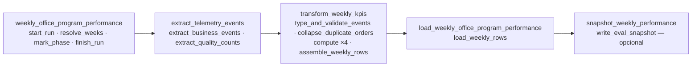

# Pipeline de desempeño de negocio — Parte 3 (subflows, tests y dashboard): análisis F0

**Estado: solo análisis y decisiones. Ninguna línea de código tocada.** Rama `feature/business-pipeline-subflows`, desde `main` en `ec5cdac` (PR #34 mergeada). Entrega de F0; F1 no empieza hasta que decidas §H.

Fuentes leídas: `AGENTS.md`, `.agents/rules/`, `memory-bank/`, el BRIEFING (`docs/proyectos-de-data-pipeline-diseno-implementacion-subflows-tests.md`), `data/pipelines/PIPELINE_DESIGN.md`, `data/pipelines/pipeline.py`, `data/process/weekly_performance.py`, `services/reporting/{router,reads,schemas}.py`, `uis/backoffice/{CLAUDE.md,app/telemetry,components/telemetry,hooks/use-telemetry-report.ts,services/telemetry-report.service.ts}`, los tests de `data/pipelines/tests` y `data/process/tests`, `data/Dockerfile`, `data/.dockerignore`, `docker-compose.yml` y `docs/reporting/compose-ephemeral.yml`.

## 0. Resumen ejecutivo

| Punto | Recomendación |
|---|---|
| Subflows | 4: `extract_telemetry_events`, `transform_weekly_kpis`, `load_weekly_office_program_performance` y el opcional `snapshot_weekly_performance`. Datos por parámetros y retornos; el flow principal conserva `start_run`, `resolve_weeks`, `mark_phase`, `finish_run`, el resumen y el fallo manejado. |
| Tasks por KPI | `compute_total_material_cost`, `compute_kits_delivered_count`, `compute_shortage_events_count`, `compute_cost_variance_events_count`, más `type_and_validate_events`, `collapse_duplicate_orders` y `assemble_weekly_rows`. Son envoltorios finos; la lógica sigue en `data/process/weekly_performance.py`. Resultado idéntico (0 diferencias). |
| Tests | `tests/pipelines/test_pipeline.py` (12 tests, `.fn`, sin motor), conftest que añade las rutas, sin `__init__.py`. Los 64 tests del pipeline y los 18 de `data/process` se quedan donde están. |
| pytest | Dependencia nueva: **necesito tu autorización** (§C.5). |
| Docker | `docker run` con la imagen `nexova-pipeline:dev`, montando solo `data/`, `packages/` y `tests/` (sin `.env`). |
| Dashboard | `/reporting`, sin librerías, sin cambios en `services/reporting`. Valencia y Miami lado a lado; EUR y USD nunca se suman. |
| Mejoras opcionales | Ninguna de backend. Lock, checkpoint, reintentos y conciliación ya están hechos. Solo la señal de «datos desactualizados» dentro del dashboard. |

Tres hallazgos que cambian el diseño y que debes conocer antes de decidir (detalle en cada sección):

1. **Los parámetros de un subflow se guardan en el servidor de Prefect.** `Flow.serialize_parameters` (`prefect/flows.py:706-745`) los envía a la API de Prefect al crear el flow run. Un subflow `transform_weekly_kpis(events, …)` dejaría `event_id`, `order_id`, cantidades y costes en la SQLite del servidor. No son datos personales, pero hoy **nada** de eso se persiste fuera de la base (A.4 y H3).
2. **El repositorio de la base no puede ser un parámetro de subflow.** Si lo fuera, el serializador de Prefect intentaría recorrerlo y podría dejar la URL de la base en el servidor. «No usa globales» se cumple para los **datos**; la conexión se resuelve dentro del subflow con `get_repository()` (A.3 y H2).
3. **Tipos incorrectos hoy tumban la transformación en lugar de contarse como rechazados.** `_positive_int` y `_positive_decimal` llaman a `.strip()`: un `quantity` entero o un `unit_cost` `float` lanza `AttributeError`. Con datos reales (siempre texto) no pasa, pero el test defensivo que pide el enunciado lo destapa (C.4 y H4).

---

## A. Topología de subflows

### A.1 Nombres, firmas y reparto

Los nombres salen del BRIEFING: la tabla `telemetry_events` (origen), `weekly_office_program_performance` (destino) y los nombres de los campos de §4. Ninguno se llama `extract_data`.

| Subflow | Firma (todo explícito) | Tasks que contiene | ¿Necesita BD? |
|---|---|---|---|
| `extract_telemetry_events` | `(week_from: date, week_to: date) -> ExtractionResult` | `extract_business_events`, `extract_quality_counts` (sin cambios) | Sí |
| `transform_weekly_kpis` | `(events: list[ExtractedEvent], quality: QualityCounts, week_from: date, week_to: date) -> TransformResult` | `type_and_validate_events`, `collapse_duplicate_orders`, las 4 `compute_*` y `assemble_weekly_rows` (B) | No |
| `load_weekly_office_program_performance` | `(result: TransformResult, week_from: date, week_to: date, run_id: UUID) -> LoadOutcome` | `load_weekly_rows` (sin cambios: 2×30 s, `retry_condition_fn`) | Sí |
| `snapshot_weekly_performance` (opcional) | `(output_dir: str, run_id: UUID, week_from: date, week_to: date, result: TransformResult, outcome: LoadOutcome) -> str \| None` | `write_eval_snapshot` (sin cambios) | No (disco) |

Tipos nuevos, todos `dataclass(frozen=True, slots=True)` y **en `data/process/weekly_performance.py`** (puros, sin Prefect):

- `ExtractionResult(events: tuple[ExtractedEvent, ...], quality: QualityCounts)`.
- `LoadOutcome(rows_upserted: int, rows_deleted: int)`. Sustituye a la tupla `(int, int)` de hoy.

**Flow principal** (`weekly_office_program_performance(trigger, week_start, requested_by)`, firma y nombre intactos): conserva `requested_weeks`, `uuid4`, `start_run`, `resolve_weeks`, los dos `mark_phase`, `finish_run`, `close_failed`, `_summary` y el logger. Solo cambia el cuerpo del `try`: en lugar de llamar a 6 tasks, llama a 3 subflows y al opcional.



Cuerpo del `try`, tal como quedaría (resumen, no código a pegar):

```text
resolve_weeks(...)                                           # task, igual que hoy
extraction = extract_telemetry_events(week_from, week_to)    # subflow; si falla, lanza → except → close_failed(fase extract)
mark_phase(run_id, "transform"); phase = "transform"
result = transform_weekly_kpis(extraction.events, extraction.quality, week_from, week_to)
mark_phase(run_id, "load"); phase = "load"
load_state = load_weekly_office_program_performance(result, week_from, week_to, run_id, return_state=True)
if load_state.is_failed(): close_failed(load_state.result(raise_on_failure=False)); return Failed(...)
snapshot_state = snapshot_weekly_performance(..., return_state=True)   # opcional, como pide el enunciado
finish_run(completed ...)
```

Extracción y transformación se llaman **sin** `return_state`: si fallan, lanzan y las recoge el `except Exception` actual, igual que hoy con las tasks. La carga y el opcional van con `return_state=True`.

### A.2 Cómo se preserva cada comportamiento actual

| Comportamiento | Cómo se preserva | Cómo se demuestra en F1 |
|---|---|---|
| **Fallo de la carga** → `finish_run` `failed`/`load`, flow `Failed`, salida 1 | La carga sigue con `return_state=True`, ahora sobre el subflow. `close_failed` sigue en el flow principal; `main()` sigue devolviendo `0 if state.is_completed() else 1`. | Test de `test_flow.py` existente (`test_load_failure_is_handled_with_return_state`) sin debilitarlo; salida 1 en el efímero con la base caída. |
| **`error_class` correcto** | Con `return_state=True`, `load_state.result(raise_on_failure=False)` debe devolver la excepción original (`OperationalError`), no un envoltorio. **No lo doy por supuesto**: parada 1 lo comprueba con un test; si Prefect la envolviera, se desenvuelve antes de guardarla. | Aserción sobre `error_class` en el log. |
| **Reintentos solo transitorios de la carga (2×30 s)** | Siguen en la task `load_weekly_rows` (`retries=2`, `retry_delay_seconds=30`, `retry_condition_fn=_retry_transient_only`). Los subflows se declaran con `retries=0`: si no, los reintentos del subflow se **multiplicarían** con los de la task (3×3 intentos). | Los tests de `RetryTests` y uno nuevo que declara `retries == 0` en los 4 subflows. |
| **Caché de 1 h del transform** | Ver B.4: las 4 tasks `compute_*` llevan `cache_key_fn` y `cache_expiration=1 h`. La segunda corrida muestra `Cached` en ellas. | Test de caché adaptado (cuenta de llamadas a la función pura) y la UI de Prefect en el efímero. |
| **Checkpoint de fase** | `mark_phase` y la variable `phase` siguen en el flow principal, en los mismos puntos: tras la extracción (`transform`) y tras la transformación (`load`). Un fallo dentro de un subflow deja la fase de antes de llamarlo. | Test que falla cada subflow y comprueba la `phase` de `pipeline_runs`. |
| **Backfill** | `backfill_weekly_office_program_performance` llama al flow principal como subflow, una vez por semana. No cambia: el principal sigue siendo un flow, ahora con subflows dentro (3 niveles). | `BackfillTests` existente + backfill de 2 semanas en el efímero. |
| **Deployments y `trigger.py`** | `serve.py` registra `pipeline.weekly_office_program_performance` con los mismos nombres de deployment y parámetros; `trigger.py` solo pide un flow run al deployment `manual`. **Ninguno de los dos cambia.** Los subflows no se despliegan. El worker monta el código y se reinicia a mano. | `test_trigger_and_serve.py` sin cambios; disparo manual en el efímero. |
| **CLI** | `__main__`, `main()`, `_parser`, salidas 0/1/2, `--week-start`, `--from/--to` y §4.5 no se tocan (ver A.5). | Los 18 tests de `test_config_and_cli.py`. |
| **Resumen y logs** | `_summary` y `close_failed` no cambian; solo la tupla `(upserted, deleted)` pasa a `LoadOutcome`. | Test del resumen. |

### A.3 «Ejecutable de forma independiente»: qué significa para cada subflow

Lo entiendo así: **se puede llamar solo desde Python, con sus entradas explícitas, sin pasar por el flow principal ni por `main()`.** No es un comando de CLI nuevo (la CLI no cambia).

| Subflow | Qué necesita | Cómo se demuestra |
|---|---|---|
| `transform_weekly_kpis` | Solo Prefect (en el script, un servidor efímero; en tests, `prefect_test_harness`). **Ni BD ni `.env`.** | Test con eventos en memoria; en el README, un ejemplo de 5 líneas. |
| `snapshot_weekly_performance` | Solo disco. | Test con un directorio temporal. |
| `extract_telemetry_events` | Un repositorio con BD. Sin BD, un `InMemoryRepository`. | Test con el repositorio en memoria; manual contra el Postgres efímero. |
| `load_weekly_office_program_performance` | Un repositorio **y un `run_id` que exista en `reporting.pipeline_runs`**: `weekly_office_program_performance.run_id` tiene FK a esa tabla. | Test con el repositorio en memoria; manual en el efímero, creando antes la fila con la task `start_run`. **Esta limitación se documenta, no se esconde.** |

**La excepción de los «globales» (H2).** Hoy las tasks piden el repositorio a `get_repository()` (variable de módulo `_repository`). Meterlo como parámetro del subflow no es seguro: `serialize_parameters` llama a `jsonable_encoder`, que recorre los atributos de un objeto desconocido y podría arrastrar el `Engine` con la URL de la base al servidor de Prefect (el fallback `<Tipo>` solo salta si la serialización lanza). Recomiendo: **los datos van todos por parámetros y retornos; la conexión sigue resolviéndose dentro, por configuración** (`DATABASE_URL` o block de Prefect). Si prefieres el parámetro explícito, habría que envolverlo en una clase con `__repr__` y serialización vacías; no lo recomiendo.

### A.4 Qué guarda Prefect de los parámetros (hallazgo 1)

| Parámetro | ¿Se guarda en el servidor de Prefect? | Contenido |
|---|---|---|
| `week_from`, `week_to`, `run_id`, `output_dir` | Sí | Fechas, UUID de la corrida, ruta del snapshot. Sin riesgo. |
| `events: list[ExtractedEvent]` | **Sí (probable)** | `event_id`, `event_type`, `timestamp`, `office`, `programme_id`, `currency`, `quantity`, `unit_cost`, `order_id`. **No** `user_id`, `session_id`, `supplier_key` ni `assigned_to` (la extracción nunca los lee). |
| `quality: QualityCounts` | Probablemente no | Sus claves son tuplas; `jsonable_encoder` falla y Prefect guarda `<QualityCounts>`. |
| `result: TransformResult` | Sí | Agregados por celda; sin identificadores. |

**Recomendación:** aceptarlo, porque los subflows exigen entradas explícitas, los campos no son datos personales y el servidor es interno (sin puerto fuera de Compose, SQLite en un volumen). A cambio:

1. Se **verifica** en la parada 1 leyendo `flow_run.parameters` del efímero (no se asume).
2. Se documenta en `PIPELINE_DESIGN.md` §4.3/§4.4 y en `data/pipelines/README`, y se corrige la frase de D6 «los resultados guardados no llevan identificadores», que seguiría siendo cierta para los *resultados* pero no para los *parámetros*.
3. `transform_weekly_kpis` no persiste su resultado de flow (por defecto no se persiste).

Alternativa (no recomendada): `extract_telemetry_events` devuelve los eventos con `event_id` sustituido por su posición ordenada, que conserva el desempate de §2.5 sin exponer UUIDs. Cambia la caché y el orden de dedup, y el valor de seguridad es marginal.

### A.5 Lo que no se reconstruye

`pipeline.py` sigue siendo el mismo archivo: no se mueve ni se divide. Quedan intactos `PIPELINES_DIR`, `REPO_ROOT`, las variables de Prefect, `set_repository`/`get_repository`, `_PERMANENT_ERRORS`, `_retry_transient_only`, `_db_task`, `start_run`, `resolve_weeks`, `mark_phase`, `finish_run`, `write_eval_snapshot`, `transform_cache_key` (adaptada, ver B.4), `_flow_run_id`, `_summary`, el backfill, la CLI y `__main__`. Los subflows se definen en el mismo `pipeline.py`, así `serve.py`, los tests y los `mock.patch.object(pipeline, …)` actuales siguen funcionando.

---

## B. Tasks de transformación por KPI

### B.1 Los KPI, verificados contra el BRIEFING §4

| Columna | KPI del BRIEFING | Fórmula |
|---|---|---|
| `total_material_cost` | Costo de material por oficina/programa | Σ `unit_cost × quantity` de `inbound_order_created`, en `Decimal`, en la moneda de la oficina |
| `kits_delivered_count` | Kits entregados | Conteo de `outbound_order_created` (órdenes, no unidades: D4) |
| `shortage_events_count` | Frecuencia de escasez | Conteo de `stock_threshold_triggered` |
| `cost_variance_events_count` | Frecuencia de variación de costo | Conteo de `kit_cost_variance_detected` |
| `currency` | — | `EUR`/`USD` por oficina; nunca se convierte ni se suma |

La lista de 4 coincide con la que me diste (y con `WeeklyRow`, el DDL y `_Cell`).

### B.2 Lógica pura en `data/process`, tasks como envoltorios

`transform()` hoy hace 5 cosas en un solo cuerpo. Se parte **dentro de `weekly_performance.py`** en funciones puras con nombre propio, y `transform()` pasa a ser su composición (misma firma, mismo resultado):

| Función pura (`data/process`) | Qué hace (hoy, en `transform`) | Task envoltorio (`pipeline.py`) |
|---|---|---|
| `type_and_validate(events, week_from, week_to) -> TypedEvents` | Pasos 1–3: tipar, `_unassigned`, `week_start` UTC, rechazos | `type_and_validate_events` |
| `collapse_duplicate_orders(typed) -> DedupedEvents` | Paso 4: una orden cuenta una vez por semana | `collapse_duplicate_orders` |
| `total_material_cost_by_cell(kept) -> dict[CellKey, Decimal]` | Σ `unit_cost × quantity` | `compute_total_material_cost` |
| `kits_delivered_by_cell(kept)` | Conteo de salidas | `compute_kits_delivered_count` |
| `shortage_events_by_cell(kept)` | Conteo de cruces | `compute_shortage_events_count` |
| `cost_variance_events_by_cell(kept)` | Conteo de variaciones | `compute_cost_variance_events_count` |
| `assemble_rows(kept, kpis…, quality, weeks) -> TransformResult` | Pasos 5–7: celdas con ≥ 1 evento, una moneda por celda, `reconcile` | `assemble_weekly_rows` |

`CellKey = (office, programme_id, week_start)`. `TypedEvents(items, rejected)` y `DedupedEvents(items, duplicates_collapsed)` son dataclasses puras; `_Typed` pasa a llamarse `TypedEvent` (público, porque ahora es la entrada y salida de tasks). Los nombres de las tasks son `compute_<columna>` y la columna es el nombre del BRIEFING; en el docstring de cada una va el nombre del KPI en español.

Cada task es una línea: `return total_material_cost_by_cell(kept)`. **Sin duplicar la lógica y sin `Decimal`/`if` en `pipeline.py`.**

### B.3 Qué se mantiene, y por qué

| Regla | Dónde vive después del cambio |
|---|---|
| Dedup por orden, primero por `(timestamp, event_id)` | `collapse_duplicate_orders` (el mismo `sort` y el mismo `seen`); `duplicates_collapsed` sale de su retorno y llega a `TransformStats` |
| Rechazo con dos monedas en una celda | `assemble_rows` lanza `DataQualityError`; la task tiene `retries=0` (permanente) |
| Cubo `_unassigned` | `type_and_validate`, igual que hoy (`programme is None → UNASSIGNED_PROGRAMME`) |
| `rows_rejected` | `type_and_validate` (incluye lo que cae fuera de la ventana) |
| Una fila por celda con ≥ 1 evento, sin filas a 0 | `assemble_rows` toma el universo de celdas de `kept`, no de los KPI: una celda que solo tuvo escasez sigue saliendo con costo 0 |
| `reconcile` | Sin cambios; sigue recibiendo `business_by_week_office`, que se calcula en `assemble_rows` a partir de `kept` |

**¿Cambia algún resultado? No.** Es una refactorización sin cambio de reglas. `TRANSFORM_VERSION` sigue en `"1"` (la clave de caché cambia de forma, así que las entradas viejas no pueden coincidir). Se prueba de tres maneras: los 18 tests de `data/process` **sin modificar ninguna aserción**; un test nuevo que compara `transform()` con la cadena de las 7 funciones sobre las mismas entradas; y `pipeline-check.sql` con **0 diferencias** en el efímero (el seed existente, `pipeline-seed-ephemeral.sql`).

### B.4 La caché de 1 h con 4 tasks (hallazgo de diseño)

Hoy la caché está en una sola task cuyo resultado son agregados sin identificadores. Con la división hay que decidir dónde va:

| Opción | Efecto | Veredicto |
|---|---|---|
| **A. Cachear las 4 `compute_*`** con una `cache_key_fn` común (SHA-256 de `TRANSFORM_VERSION`, el nombre de la task, las semanas y los campos de los eventos que afectan a ese KPI) | La segunda corrida muestra `Cached` en las 4; el ahorro es real. Las 3 tasks que reciben o devuelven identificadores (`type_and_validate_events`, `collapse_duplicate_orders`, `assemble_weekly_rows`) **no se cachean ni persisten**: si se persistiera `collapse_duplicate_orders` quedarían `event_id` y `order_id` en `data/raw/…/prefect-results`, y D6 lo prohíbe | **Recomendada** |
| B. Cachear solo `assemble_weekly_rows` | Muestra `Cached`, pero el cálculo caro se repite: la caché sería decorativa | Descartada |
| C. Mantener `transform_weekly_rows` como task cacheada que llama a la función pura, y las `compute_*` aparte | Dos caminos de cálculo para lo mismo | Descartada (duplica) |

Con la opción A, `transform_cache_key(context, parameters)` cambia de firma interna (lee `parameters["kept"]` y el nombre de la task) y se actualizan 2 tests de `test_flow.py` (`test_second_run_within_the_hour_does_not_recompute` cuenta llamadas a `transform` y `test_cache_key_depends_on_every_event`). Se adaptan, no se borran: el criterio sigue siendo «segunda corrida con los mismos eventos no recalcula; un evento más, sí».

`.submit()` en paralelo para las 4 `compute_*` **no se recomienda**: leen listas inmutables en memoria, el cálculo es de milisegundos y secuencial conserva el orden de los logs.

---

## C. Tests

### C.1 Cómo se llaman las tasks en aislamiento

`task.fn(...)` ejecuta la función Python sin motor, servidor ni estado de Prefect. Se importa `pipeline` (que importa Prefect, pero no arranca nada al importar). Por eso los tests de `tests/pipelines/` necesitan **Prefect instalado** (venv de `data/pipelines` o la imagen), no un servidor. La independencia de los subflows (que sí necesita servidor) se prueba aparte, en `data/pipelines/tests/test_subflows.py` con `prefect_test_harness`.

### C.2 Relación con los tests existentes

Los 64 tests de `data/pipelines/tests` (unittest: 4+18+15+7+5+7+8) y los 18 de `data/process/tests` **se quedan donde están**: AGENTS.md §4 y la imagen (`**/tests` en `data/.dockerignore`) dependen de esa ubicación. El archivo nuevo de la raíz es una capa añadida con el nivel que pide el enunciado: tasks por KPI contra un contrato de datos. Se adaptan 2 tests de caché (B.4) y se añaden `test_subflows.py` y tests de las funciones puras nuevas; ningún test existente se borra ni se debilita sin avisarte.

### C.3 Imports desde la raíz, sin romper nada

- `tests/pipelines/conftest.py` añade a `sys.path` `data/pipelines` (y, por si acaso, `data/process` y `packages/shared`; `business_performance/_bootstrap.py` ya lo hace si faltan).
- **Sin `__init__.py` en `tests/` ni en `tests/pipelines/`.** Con él, `tests` sería un paquete que choca con `data/pipelines/tests` (`from tests.support import …`) y rompería los 64 tests. Sin él, pytest inserta `tests/pipelines` en `sys.path` y no hay colisión.
- **Sin `pytest.ini` ni `pyproject.toml` en la raíz** (hoy no existen): el comando lleva la ruta explícita. `python -m pytest` sin ruta recogería también `services/api` y no está soportado; se documenta.
- La suite de `services/api` corre desde `services/api` con su propia configuración y no la afecta.
- Los 64 se comprueban en F1 con el comando de `AGENTS.md` y, para los 18 de `data/process`, con `python -m unittest discover -s data/process/tests -t data/process`.

### C.4 Lista de tests (fixtures en memoria, forma de `telemetry_events`)

**Fixtures.** Una función `telemetry_row(...)` construye un diccionario con las columnas reales de `telemetry_events` (`event_id`, `event_type`, `timestamp` con zona, `service`, `schema_version`, `tags` con las claves de la allowlist) y `extracted(rows)` aplica la misma proyección que la SQL de §2.3 (`tags->>'office'`, `COALESCE(inbound_order_id, outbound_order_id)`) para producir `ExtractedEvent`. Así los tests ejercitan el contrato real, no atajos. Sin BD, sin red, sin servidor, datos ficticios.

Semana de prueba: lunes **2026-11-02** (UTC), `week_from == week_to`.

| # | Test | Entrada | Esperado | Cálculo a mano |
|---|---|---|---|---|
| 1 | `test_total_material_cost_sums_unit_cost_times_quantity` | Valencia, 2 `inbound_order_created`: cantidad 4 × 12,50 y cantidad 2 × 3,25 | `Decimal("56.50")`, `EUR` | 4×12,50 = 50,00; 2×3,25 = 6,50; 50,00 + 6,50 = **56,50** |
| 2 | `test_kits_delivered_counts_orders_not_units` | Miami, 3 salidas con cantidades 12, 1 y 5 | `kits_delivered_count == 3` (no 18) | D4: una orden = 1 |
| 3 | `test_shortage_events_count_counts_threshold_crossings` | 2 `stock_threshold_triggered` de órdenes distintas en 2026-11-02 y 1 en 2026-11-09 | semana 1 → 2; semana 2 → 1 | Conteo por semana |
| 4 | `test_cost_variance_events_count_counts_variations_per_cell` | 2 `kit_cost_variance_detected` en Valencia y 1 en Miami | 2 y 1; costo 0 en ambos | Conteo por celda |
| 5 | `test_week_report_matches_hand_calculation` (**KPI vs valor a mano del BRIEFING**) | Valencia: entradas 10×18,50 y 5×20,00; salidas 4 órdenes; 1 escasez; 1 variación. Miami: entrada 3×40,00; 2 salidas | Valencia `285.00` EUR, 4, 1, 1. Miami `120.00` USD, 2, 0, 0 | Valencia: 185,00 + 100,00 = 285,00. Miami: 3×40,00 = 120,00. Se compara con `WeeklyRow` completa |
| 6 | `test_valencia_and_miami_are_never_mixed` | Un evento por oficina | 2 filas: `valencia`→`EUR`, `miami`→`USD`; ninguna fila con ambas | BRIEFING §7 |
| 7 | `test_missing_programme_goes_to_unassigned_bucket` | `programme_id` nulo y uno con slug `programa-ficticio` | filas `_unassigned` y `programa-ficticio` por separado | D1 |
| 8 | `test_same_order_with_two_event_ids_counts_once` | 2 salidas con el mismo `outbound_order_id` y distinto `event_id` | `kits_delivered_count == 1`, `duplicates_collapsed == 1` | §2.5 paso 4 |
| 9 | `test_week_start_is_the_utc_monday` | Domingo 2026-11-08 23:30Z y lunes 2026-11-09 00:00Z | semanas 2026-11-02 y 2026-11-09 | §2.5 paso 3 |
| 10 | **`test_malformed_events_are_rejected_not_crashing`** (defensivo) | 9 eventos malos: `quantity` `"abc"`, `"1.5"` y `0`; `unit_cost` `None`, `"-5"` y `"NaN"` en una entrada; `office` `"madrid"`; `timestamp` sin zona; moneda que no es la de la oficina | 0 filas, `rows_rejected == 9`, sin excepción | Cada uno incumple el §2.5 paso 1 |
| 11 | **`test_wrong_types_are_rejected_not_crashing`** (defensivo, tipos) | `quantity` como `int`, `unit_cost` como `float`, `order_id` como `None` | rechazados y contados, sin `AttributeError` | **Falla hoy**; requiere H4 |
| 12 | `test_empty_input_means_no_rows` | `[]` | `rows == ()`, KPI en `{}` | §2.5 paso 6 |

Los tests 1–4 y 6 llaman a las tasks `compute_*`/`assemble_weekly_rows` con `.fn`; el 5, a la cadena completa de `.fn`. Cubre «al menos 3 tasks de KPI», «al menos 1 defensivo» (10 y 11) y «al menos 1 contra un valor a mano» (5). El caso de dos monedas en una celda ya lo cubre `data/process/tests` (es inalcanzable con el tipado) y no se duplica.

### C.5 pytest: dependencia nueva — **necesito tu autorización**

`pytest` no está en `data/pipelines/pyproject.toml` ni en su `uv.lock`. Propuesta (la misma versión que ya usa `services/api`, autorizada allí por AUTH-088):

1. En `data/pipelines/pyproject.toml`: `[dependency-groups] dev = ["pytest>=9.1,<9.2"]`. **Solo grupo de desarrollo**: `requirements.txt` (el de la imagen, `uv export --no-dev`) no cambia.
2. `uv lock` (nunca `uv sync`) regenera `uv.lock`. Añade `pytest` y sus transitivas (`pluggy`, `iniconfig`, y las ya presentes).
3. Nuevo `data/pipelines/requirements-dev.txt`, con hashes: `uv export --frozen --only-group dev --no-emit-project --format requirements-txt -o requirements-dev.txt`.
4. `test_requirements_lock.py` se amplía para comprobar que ese archivo sigue a `uv.lock`.

Impacto: 0 en la imagen de producción, 0 en `services/api` (entorno propio), 0 en `package.json`. **No hago nada de esto hasta tu OK.**

### C.6 Comandos exactos

**Docker (el principal en este host, donde el Control de aplicaciones de Windows bloquea DLLs de los venvs).** Imagen `nexova-pipeline:dev`. Se monta **solo `data/`, `packages/` y `tests/`: el `.env` de la raíz no entra**, así que ni por error se lee la URL de la demo.

```powershell
# Tests (desde la raíz). Instala pytest con hashes dentro del contenedor desechable.
docker run --rm -v "${PWD}/data:/repo/data" -v "${PWD}/packages:/repo/packages" -v "${PWD}/tests:/repo/tests" -w /repo -e PYTHONPATH=/repo/data/pipelines:/repo/data/process:/repo/packages/shared nexova-pipeline:dev sh -c "uv pip install --system --no-cache --require-hashes -q -r data/pipelines/requirements-dev.txt && python -m pytest -p no:cacheprovider tests/pipelines/test_pipeline.py"
```

```powershell
# El ETL completo (solo contra el Postgres efímero; DATABASE_URL = el del efímero, desde la terminal, nunca escrita aquí).
docker run --rm --network nexova-net -e DATABASE_URL -v "${PWD}/data:/repo/data" -v "${PWD}/packages:/repo/packages" -w /repo -e PYTHONPATH=/repo/data/pipelines:/repo/data/process:/repo/packages/shared nexova-pipeline:dev python data/pipelines/pipeline.py --week-start 2026-11-02
```

`-e DATABASE_URL` sin valor toma el de la terminal. La primera línea que imprime el script es el host: debe decir `nexova-pipeline-pg`. Escribe en `data/raw/` y `data/eval/` del host, que están en `.gitignore`. Alternativa, que añadiría una etapa `test` al `data/Dockerfile`: descartada, porque la última etapa es la que se construye por defecto y obligaría a tocar Compose (H8).

**Entorno uv (quien no tenga el bloqueo), desde la raíz:**

```powershell
uv pip install --python data\pipelines\.venv\Scripts\python --require-hashes -r data\pipelines\requirements-dev.txt
data\pipelines\.venv\Scripts\python -m pytest tests/pipelines/test_pipeline.py
data\pipelines\.venv\Scripts\python data\pipelines\pipeline.py --week-start 2026-11-02
```

En Linux/macOS, `.venv/bin/python`. Se usa `uv pip install`, no `uv sync` (`AGENTS.md` §4).

---

## D. Dashboard `/reporting`

### D.1 Ruta, componentes y fetch

Mismo patrón que `/telemetry`: `app/reporting/page.tsx` (Server Component con metadata) → `components/reporting/weekly-performance-view.tsx` (`'use client'`) → `hooks/use-weekly-performance.ts` y `hooks/use-pipeline-freshness.ts` (reducer puro + sesión sin React + hook, con cancelación y descarte de respuestas tardías) → `services/reporting.service.ts` → `lib/api-client.ts` (el único `fetch`; adjunta el `Bearer` y trata el 401). `unknown` solo en `services/normalizers.ts`. Tipos en `types/reporting.ts`. **Sin variable de entorno nueva:** va por el mismo `NEXT_PUBLIC_API_URL=/backend`, es decir `/backend/reporting/…`; el navegador nunca habla con el 8000. No colisiona con el rewrite: Next sirve `/reporting` y el rewrite solo reenvía `/backend/*`.

Componentes presentacionales: `kpi-block.tsx` (un bloque por KPI), `office-comparison.tsx` (las dos columnas), `week-picker.tsx`, `data-freshness.tsx`. Formato y reglas en `lib/reporting-format.ts` (puro, probado con Jest).

### D.2 Roles y navegación

El endpoint acepta cualquier rol y el backoffice **no filtra enlaces por rol** (`account-nav.tsx` muestra los mismos a `admin`, `manager` y `user`). Recomiendo lo mismo: **cualquier usuario con sesión**; la API es la autoridad. Enlace «Reporte semanal» en la cabecera, junto a «Inventario» y antes de «Telemetría». **Sin botón de «ejecutar ahora»:** el `POST` es solo `admin` y no está en el enunciado.

### D.3 Sin librerías

Tablas y barras de CSS, como `/telemetry`. Una barra decorativa (`aria-hidden`) solo donde la comparación tiene sentido (D.5).

### D.4 Un bloque por KPI, con su nombre del BRIEFING

Cuatro bloques, en este orden, cada uno con el nombre literal del BRIEFING §2 como título, la frase «Qué mide» del BRIEFING como subtítulo y el período a la vista:

| Título (BRIEFING) | Subtítulo (lo que mide, §2) | Columna |
|---|---|---|
| Costo de material por oficina/programa | Cuánto gastó cada oficina en material de formación e incorporación durante la semana. | `total_material_cost` |
| Kits entregados | Cuántos kits o certificados se entregaron a clientes, candidatos, consultores o agentes durante la semana. | `kits_delivered_count` |
| Frecuencia de escasez | Cuántas veces el stock cayó por debajo del mínimo configurado durante la semana. | `shortage_events_count` |
| Frecuencia de variación de costo | Cuántas veces el costo de un proveedor subió de forma anómala respecto a su histórico durante la semana. | `cost_variance_events_count` |

Una línea fija de contexto: «Un kit entregado es una orden de salida, sin importar cuántas unidades lleve». Es la definición D4 (órdenes, no unidades) y evita que Elena lea 3 como 3 unidades.

### D.5 Período, Valencia frente a Miami y monedas

- **Período:** encabezado de la página con «Semana del lunes 2 al domingo 8 de noviembre de 2026» a partir de `week_start` (`week_start + 6 días`; las semanas son lunes–domingo en UTC, con nota breve «horario UTC»). Se repite junto al título de cada bloque.
- **Selector:** el endpoint solo acepta `week_start` y **no hay un listado de semanas calculadas**. Recomiendo **«← Semana anterior» y «Semana siguiente →»** (±7 días sobre la semana mostrada) más el texto del período. Sin parámetro, la API devuelve la última semana calculada, y esa es la primera carga. «Siguiente» se desactiva en la última semana calculada (la de la primera carga); un 404 `week_not_computed` se muestra como «Esta semana todavía no se ha calculado», **no como un error**, y «Semana anterior» sigue disponible. Estado solo en memoria (sin URL, sin `localStorage`).
- **Comparación:** cada bloque tiene dos columnas, **Valencia (EUR)** y **Miami (USD)**, en pantalla ancha lado a lado y apiladas a 375 px sin scroll horizontal (con `relative` en todo `overflow-x-auto`, regla del backoffice). En cada columna, el subtotal de esa oficina (suma de sus programas, misma moneda) y debajo, si hay más de un programa, una fila por programa.
- **EUR y USD nunca se suman ni se convierten.** No hay ningún total «entre oficinas». Una nota fija: «Valencia se expresa en euros y Miami en dólares; las cifras no se suman ni se convierten».
- **Barras:** en los tres KPI de conteo (kits, escasez, variación) una barra por oficina con **escala común** (son comparables). En el **costo, sin barra comparativa**: 16 EUR junto a 3 USD con la misma escala sugeriría una comparación que no existe. Solo los importes.
- **Suma de costes:** la API devuelve `total_material_cost` como número JSON (flotante). Para el subtotal se suma en **céntimos enteros** (`Math.round(x * 100)`) y se formatea con `Intl.NumberFormat('es-ES', { style: 'currency', currency })`. Esa función es pura y se prueba.
- **Oficina sin fila:** «Sin actividad esta semana», no un `0` inventado (el diseño no inventa filas a 0).

### D.6 `_unassigned` sin jerga

`programme_id = '_unassigned'` se muestra como **«Sin programa asignado»**, nunca el literal. Mientras todas las filas sean `_unassigned` (P1 pendiente), en lugar de una tabla de un solo programa va una nota: «El material todavía no está clasificado por programa; por ahora las cifras de cada oficina se muestran juntas.» Cuando haya programas reales y `_unassigned` a la vez, las filas reales van primero y «Sin programa asignado» al final.

### D.7 Frescura de los datos

Franja «Datos actualizados» con `GET /reporting/pipeline-runs/latest`, con su propia carga y error (si falla, el reporte sigue visible, como el resumen de `/incident-manager`):

| Estado de la última corrida | Texto |
|---|---|
| `completed` | «Actualizado el 9 nov 2026, 06:03» (`finished_at`, hora local) y las semanas que cubrió (`week_from`–`week_to`) |
| `running` | «Actualizando los datos…» |
| `failed` | «La última actualización falló; las cifras pueden ser de una corrida anterior.» Sin `error_class` ni fase (jerga) |
| 404 `pipeline_run_not_found` | «El reporte todavía no se ha calculado.» |
| `completed` hace más de 8 días | Aviso «Los datos pueden estar desactualizados: no se ha completado ninguna actualización en la última semana». **Umbral propuesto, a confirmar:** cron semanal + 1 día de margen |

Es la única «mejora» de observabilidad que propongo (E).

### D.8 Estados

| Estado | Qué se ve |
|---|---|
| Cargando | Esqueleto con la misma rejilla de los 4 bloques + «Cargando el reporte…» (`role="status"`), sin layout shift |
| Con datos | Los 4 bloques |
| Semana calculada sin actividad (`entries: []`) | «No hubo actividad registrada en esta semana», sin bloques de ceros |
| 404 `week_not_computed` | «Esta semana todavía no se ha calculado» |
| 503 `storage_unavailable` | «El almacén de datos no está disponible ahora mismo. Inténtalo de nuevo en unos minutos.» con «Reintentar» (el servicio distingue el `code`, no solo el 5xx) |
| Error genérico, red, timeout, formato inesperado, configuración | Los textos de `/telemetry` con «Reintentar» |
| 401 | `session_expired`, y el guard redirige a `/login` |

Con un reporte en pantalla, un fallo al cambiar de semana no lo esconde (el patrón de `reportView` de `/telemetry`).

### D.9 Tests

Los dos mecanismos del backoffice, **sin dependencias nuevas**:

- `tests/reporting.test.mjs` (`node:test`): normalizador (válido, campo ausente, tipo erróneo, `entries` vacío), servicio (200, 404 `week_not_computed`, 503 `storage_unavailable`, 401, red, timeout), reducer y sesión (carreras al cambiar de semana, cancelación al desmontar, un fallo no borra el último reporte). Y los de la franja de frescura.
- `__tests__/utils/reporting-format.test.ts` (Jest): rango de la semana, suma en céntimos, formato de moneda por oficina, etiqueta de `_unassigned`, orden de programas, umbral de «desactualizado».
- Reglas en `tests/production-source.test.mjs`: la ruta `/reporting/…` de la API solo en `services/reporting.service.ts`; sin `console.*`; el componente no suma entre oficinas (se comprueba con un test de `lib/reporting-format`: la función de subtotal exige una sola moneda y lanza si recibe dos).

### D.10 ¿Cambia algo en `services/reporting`?

**No.** El `GET` ya devuelve lo necesario (`week_start`, `entries`, 404 `week_not_computed`, 503 `storage_unavailable`) y `/latest` da `status`, `finished_at`, `week_from` y `week_to`. Lo único que echo en falta es un listado de semanas calculadas para el selector; recomiendo **no** añadir una ruta que el BRIEFING no pide y resolverlo con anterior/siguiente.

### D.11 Alcance de `uis/backoffice/CLAUDE.md`

Ese archivo dice que el backoffice tiene cinco piezas de negocio y «solo estas»; cualquier otra «sigue prohibida sin un contexto de hito». El dashboard es un entregable obligatorio de este ticket (BRIEFING + tu enunciado). En F1 se añade la sección «Reporte semanal (`/reporting`)» y se ajusta esa frase. **Lo anoto como decisión tuya (H7), no lo asumo.** Como `/telemetry`, la página queda fuera del contrato de telemetría (no emite `page_viewed`; añadirlo sería la versión `1.1.0`).

---

## E. Mejoras opcionales de `PIPELINE_DESIGN.md`

Revisé el diseño y las decisiones D1–D16. Lo que dejó pendiente, frente a lo ya hecho:

**Ya implementado (la PR lo dirá):**

| Pregunta del diseño | Cómo está resuelta hoy |
|---|---|
| Dos corridas a la vez (§3.4, pregunta 10) | Índice único parcial de `pipeline_runs`, `pg_advisory_xact_lock` en la carga y concurrencia 1 del deployment |
| Corrida muerta | Fila `running` > 30 min se cierra como `Abandoned` en el siguiente `start_run` |
| Checkpoint (§3.3) | `mark_phase` en `pipeline_runs.phase` |
| Reintentos solo transitorios (§4.1) | `retry_condition_fn`, 2×10 s en E/S y 2×30 s en la carga |
| Idempotencia de `start_run` | `ON CONFLICT (run_id) DO NOTHING` |
| Distinguir «sin actividad» de «sin datos» (pregunta 4) y bajada real de pérdida (pregunta 6) | `quality` en `pipeline_runs` (conciliación) |
| Retención | Guarda de 84 días en `resolve_weeks` |
| Paso opcional | `write_eval_snapshot` con `return_state=True` |
| Analítica de Prefect | Desactivada en todos los modos |

**`Idempotency-Key`: no aplica por diseño** (§6, pregunta 1): la clave de idempotencia es el `eventId`.

**Documentado como pendiente, no implementado:**

| Pendiente | ¿Responde a una pregunta del diseño? | Recomendación |
|---|---|---|
| Roles de base de datos separados (§2.7: el pipeline con `SELECT` en origen y escritura solo en `reporting`; la API con `SELECT` en `reporting`) | Seguridad, no una pregunta de §6 | **No ahora.** Requiere crear roles en Supabase (la demo) y cambiar credenciales de la API: fuera de este ticket |
| `kits_delivered_units` (D4) y conversión de monedas (BRIEFING v2) | Definición de KPI | No: el BRIEFING manda la v1 |
| P1 y P2 (programas, mínimo por activo) | Prerrequisito de negocio | No: dependen de Elena |
| Que la purga compruebe la cobertura en `pipeline_runs` antes del 2027-02-03 (§3.4) | Pregunta 7 / retención | Es del proceso de administración, no del pipeline; **lo menciono en la PR como recordatorio** |
| Fallo con la base caída que no queda en `pipeline_runs` (§6, pregunta 7: «solo consta en Prefect») | Pregunta 7 | **La única brecha real.** La cubre sin backend la señal «datos desactualizados» del dashboard (D.7) |

**No existen en el diseño** y no los invento: lock distribuido propio, heartbeat, alerta de silencio e `Idempotency-Key`. (Una notificación requeriría un canal y credenciales que el pipeline no tiene; `implementation-analysis.md` línea 130 ya lo descartó.)

**Recomendación:** no implementar ninguna mejora de backend. Una sola anotación en `PIPELINE_DESIGN.md` §6/§8: la señal «datos desactualizados» del dashboard (umbral de 8 días), que responde a la pregunta 7 («¿qué pasa si la base no está disponible?») desde el lado del usuario. Se prioriza porque es la única brecha del diseño que Laura o Elena notarían (un reporte viejo que parece actual) y no cuesta ni un endpoint. **Si prefieres no anotar ninguna, el dashboard sigue mostrando la frescura obligatoria.**

---

## F. Lo que NO se toca

| Elemento | Garantía |
|---|---|
| `telemetry_events` | Solo lectura (la extracción no cambia). Ningún seed, lote mixto ni escritura contra la demo |
| `services/telemetry/analysis.py` y `GET /telemetry/report` | Ni una línea. Se verifica al final con `git diff main -- services/telemetry` (debe salir vacío) |
| Esquema `reporting` | Sin cambios. No hay migración nueva |
| Lock de la API (`services/api/uv.lock`, `requirements.txt`) y `services/api` | Sin cambios. `business_performance/trigger.py` y `serve.py` tampoco |
| `uis/website` | Sin cambios |
| `.env` de cualquier usuario y `.env.example` | Sin cambios |
| `services/reporting` | Sin cambios (D.10) |
| La demo (Supabase) | Nada sin tu confirmación explícita. Todo contra el Postgres efímero (`docs/reporting/compose-ephemeral.yml`) |

**Tabla de validación (`AGENTS.md` §4) que se aplicará en F1:**

| Subproyecto | Qué cambia | Comando |
|---|---|---|
| `data/process/` | Funciones puras nuevas | `python -m unittest discover -s data/process/tests -t data/process` |
| `data/pipelines/` | Subflows, tasks, tests | El de la fila de la tabla (venv, o Docker en este host): `python -m unittest discover -s data/pipelines/tests -t data/pipelines` (los 64 + los nuevos) |
| `tests/pipelines/` (nueva) | pytest de la raíz | Comando de C.6 |
| `data/pipelines/` dependencias | Solo con tu OK a pytest | `uv lock`, `uv export` y `test_requirements_lock.py` |
| `docs/reporting/pipeline-*.sql` | Cuadre | `pipeline-check.sql` en el efímero: 0 diferencias |
| `services/api/` | **No cambia.** Aun así se ejecuta su suite en F1 como comprobación de que no se rompió nada: `test_reporting_architecture.py` mira los imports de `business_performance` | Comando de `AGENTS.md` §4 |
| `uis/backoffice/` | Dashboard | `npx next typegen` (ruta nueva) + `npx tsc --noEmit` + `npm run lint` + `npm run build` + `node --disable-warning=MODULE_TYPELESS_PACKAGE_JSON --import ./tests/support/resolve-alias.mjs --test --test-timeout=10000 "tests/*.test.mjs"` + `npm run test:jest`; además, navegador (estados vacío, carga, error, 503, 375 px) |
| Docker | **No cambia** (ninguna etapa nueva, ni `requirements.txt`) | Solo `docker compose config --quiet` si se toca algo; no está previsto |
| `uis/` (servidor del website) | No cambia | — |

---

## G. Plan de F1, con paradas

Cada parada termina con un informe y **espero tu OK antes de seguir**.

### Parada 1 — Subflows y equivalencia de resultados

1. `data/process/weekly_performance.py`: las 7 funciones puras y los tipos nuevos; `transform()` como composición; endurecimiento de tipos (si H4); `TRANSFORM_VERSION` sin cambios.
2. `data/pipelines/pipeline.py`: 7 tasks (`type_and_validate_events`, `collapse_duplicate_orders`, 4 `compute_*`, `assemble_weekly_rows`), 4 subflows con `retries=0` y el flow principal reescrito sobre ellos. `transform_cache_key` adaptada. **`__main__`, `main()`, los códigos 0/1/2 y la CLI sin tocar.**
3. Tests: adaptar 2 de `test_flow.py`; nuevos `test_subflows.py` (independencia, `retries == 0`, fase correcta tras un fallo en cada subflow, `error_class` sin envoltorio) y los de las funciones puras en `data/process/tests`.
4. **Equivalencia:** 18 + 64 tests; `pipeline-check.sql` con 0 diferencias en el efímero; segunda corrida con `Cached` en las 4 `compute_*`; verificación de qué parámetros guarda Prefect (A.4); backfill de 2 semanas; corrida con la base caída (salida 1, `failed`/`load`).

### Parada 2 — Tests (necesita tu OK a pytest, C.5)

`tests/pipelines/conftest.py` y `test_pipeline.py` (12 tests); pyproject, `uv.lock`, `requirements-dev.txt` y la ampliación de `test_requirements_lock.py`; los comandos de Docker y de uv de C.6 ejecutados de verdad.

### Parada 3 — Dashboard

Tipos, normalizador, servicio, 2 hooks, `lib/reporting-format.ts`, 5 componentes, página, enlace en la cabecera; los tests de D.9; validación del backoffice; **navegador contra el stack con el efímero** (con el seed ficticio): datos, semana anterior/siguiente, 404, vacío, 503 (parando la base), API parada, 375 px, frescura con una corrida `failed`.

### Parada 4 — Documentación, memory-bank y commit

`PIPELINE_DESIGN.md` (§2.4 diagrama, §4.1 tabla de subflows, §4.3/§4.4 parámetros guardados, §6/§8 y §10 trazabilidad), READMEs de `data/pipelines` y `data/process` (cómo ejecutar un subflow solo), `AGENTS.md` §4 (fila de `tests/pipelines` y el comando de Docker), `uis/backoffice/CLAUDE.md` y `README.md`, y una guía nueva `docs/reporting/subflows-dashboard-review.md` (arranque, recorrido, qué verificar y lo no verificado). `memory-bank-sync`, `git diff main -- services/telemetry` vacío, `git status`/`git diff --stat` y el commit exacto, **sin pie de atribución**:

`feat: refactor business performance pipeline into subflows, add unit tests, and add reporting dashboard`

Sin push ni PR hasta tu OK.

### Archivos

**Crear:** `tests/pipelines/conftest.py`, `tests/pipelines/test_pipeline.py`, `data/pipelines/tests/test_subflows.py`, `data/pipelines/requirements-dev.txt` (con OK), `docs/reporting/subflows-dashboard-review.md`, `uis/backoffice/{app/reporting/page.tsx, components/reporting/{weekly-performance-view,kpi-block,office-comparison,week-picker,data-freshness}.tsx, hooks/use-weekly-performance.ts, hooks/use-pipeline-freshness.ts, services/reporting.service.ts, types/reporting.ts, lib/reporting-format.ts, tests/reporting.test.mjs, __tests__/utils/reporting-format.test.ts}`.

**Modificar:** `data/process/weekly_performance.py`, `data/process/tests/test_weekly_performance.py`, `data/process/README.md` y `README.es.md`, `data/pipelines/pipeline.py`, `data/pipelines/tests/test_flow.py`, `data/pipelines/tests/test_requirements_lock.py` (con OK), `data/pipelines/pyproject.toml` y `uv.lock` (con OK), `data/pipelines/PIPELINE_DESIGN.md`, `data/pipelines/README.md` y `README.es.md`, `AGENTS.md`, `uis/backoffice/{CLAUDE.md, README.md, services/normalizers.ts, components/auth/account-nav.tsx, tests/production-source.test.mjs}`, `memory-bank/progress.md` y `techContext.md`.

**No se tocan:** `services/**`, `packages/**`, `data/Dockerfile`, `docker-compose.yml`, `.env*`, `uis/website/**`, `data/pipelines/business_performance/**`.

---

## H. Decisiones que necesito de ti

| # | Decisión | Recomendación |
|---|---|---|
| **H1** | **Autorizar `pytest>=9.1,<9.2` como dependencia de desarrollo de `data/pipelines`** (grupo `dev`, `uv.lock`, `requirements-dev.txt`; 0 impacto en la imagen de producción y en la API) | Sí |
| H2 | La conexión a la base se resuelve **dentro** de cada subflow con `get_repository()` (no como parámetro), por el riesgo de serializarla a Prefect | Sí |
| H3 | Los parámetros del subflow de transformación (`event_id`, `order_id`, cantidades y costes, sin datos personales) se guardan en el servidor de Prefect: aceptarlo, verificarlo y documentarlo | Sí |
| H4 | Endurecer el tipado: un `quantity`, `unit_cost` u `order_id` que no sea texto se **rechaza y cuenta** en `rows_rejected` en lugar de lanzar `AttributeError`. Cambia solo entradas que hoy hacen fallar la corrida | Sí |
| H5 | Caché en las 4 `compute_*` (B.4, opción A) | Sí |
| H6 | Dashboard: `/reporting`, cualquier rol, anterior/siguiente, sin bloque de calidad de datos, aviso de desactualizado a los 8 días | Sí; el umbral de 8 días es tuyo |
| H7 | Ajustar el alcance de `uis/backoffice/CLAUDE.md` (D.11) | Sí |
| H8 | Docker: instalar pytest con hashes en un contenedor desechable (C.6), sin tocar `data/Dockerfile` ni Compose | Sí |
| H9 | Mejoras opcionales: ninguna de backend; solo anotar la señal de desactualizado | Sí |
